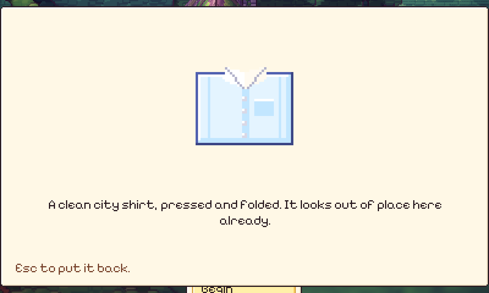
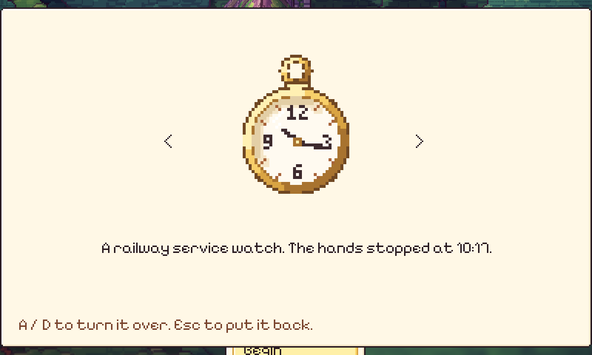

# 54. Membalik Keepsake Hanya Jika Ada Sisi Lain

**Tanggal:** 2026-10-21

## Tujuan

Pengguna membuka kemeja cadangan di tas. Layar menulis "A / D to turn it over", tapi menekan A atau D tidak mengubah
apa pun. Pengguna bertanya apakah fitur itu hanya gimik.

## Penyebab

Membalik benda memang berfungsi, tapi hanya untuk benda yang punya lebih dari satu sisi: jam saku, kelinci perca,
kamera, kunci, sepatu, dan buku besar. Kemeja, dompet, kontrak, dan barang tukar (roti, minyak damar, tali, daun mint,
benang merah, dan lainnya) hanya punya satu sisi. Tas tetap menampilkan panah `<` `>` dan petunjuk A / D untuk semua
benda, jadi untuk benda bersisi satu, A dan D membalik ke sisi yang sama.

## Yang dikerjakan

Di `UI/Bag.cs`, saat melihat sebuah benda dari dekat:

- panah hanya tampil jika benda punya sisi lain;
- petunjuk di bawah menjadi "A / D to turn it over. Esc to put it back." untuk benda bersisi banyak, dan cukup
  "Esc to put it back." untuk benda bersisi satu.

Panah yang tersembunyi juga tidak bisa diklik, karena `Look.Hit` hanya menghitung node yang aktif.

## Cara dicek

- Di editor pada 1080p: kemeja tampil tanpa panah dengan petunjuk "Esc to put it back.", jam saku tetap dengan panah
  dan petunjuk A / D.
- Semua 17 tes PlayMode lulus.
- Build macOS dan Windows dibuat ulang.

## Commit

- `86a288a` fix(ui): offer turning a keepsake over only when it has another side
