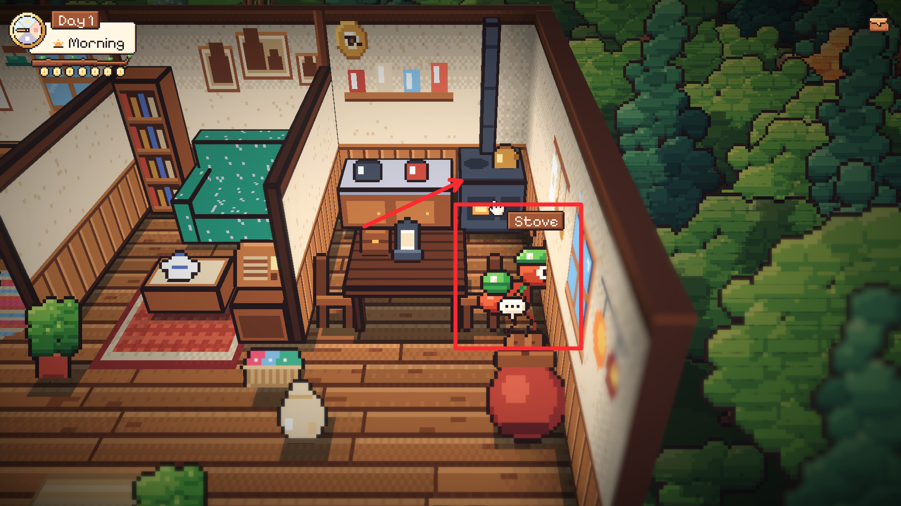
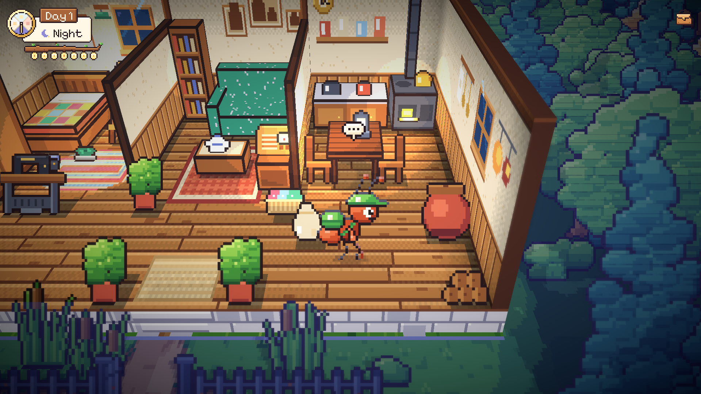
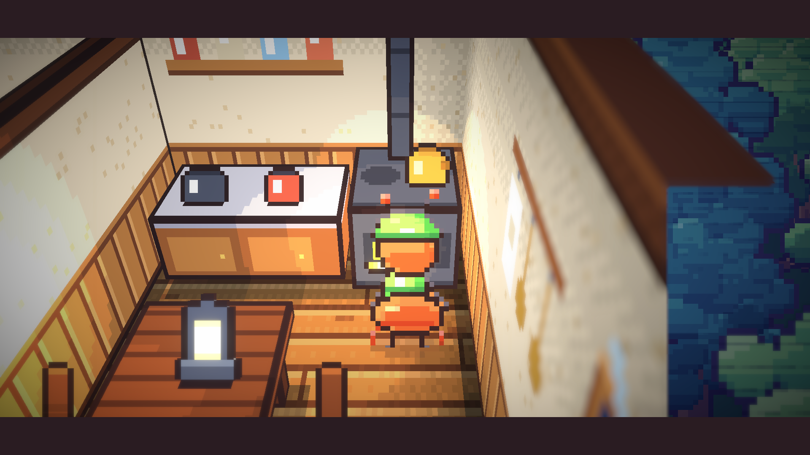

# 55. Jalan ke Tungku dan Peta Jalan yang Basi

**Tanggal:** 2026-10-21

## Tujuan

Pengguna terjebak di dapur rumah Satria saat mau ke tungku. Kurir berhenti di sela antara kursi dan dinding, jauh di
bawah tungku, dan tidak bisa maju lagi. Padahal pagi hari menyuruh pemain ke sana: "Morning. Tea's on the stove."

## Penyebab

Ada dua masalah yang saling menutupi.

1. **Kursi kanan menutup tungku.** Meja walnut lebar 36 px dan kursi kanannya berdiri tepat di antara meja dan dinding
   kanan, persis di depan tungku. Kaki semut butuh ruang 8 px ke samping, jadi lantai di depan tungku menjadi kantong
   yang tertutup dari semua sisi (meja di kiri, kursi di bawah, dinding di kanan). Ekspor peta jalan membuang kantong
   yang tidak terjangkau, sehingga titik tungku terpaksa dipasang 36 px di bawahnya, di samping kursi. Di sana kurir
   membuat teh sambil membelakangi kamera, menghadap kursi, bukan tungku.
2. **Peta jalan yang basi.** `walk.png` hanya bibit. `export.py` menulisnya hanya jika belum ada, karena peta itu boleh
   dicat ulang dengan tangan. Saat keranjang wol, karung beras, dan kayu bakar ditambahkan ke rumah, bentuk padatnya
   ikut ditulis di `inside.js`, tapi peta lama tidak pernah diperbarui. Akibatnya titik tungku jatuh tepat di atas
   tumpukan kayu bakar, dan kurir bisa berdiri di atasnya.

## Yang dikerjakan

### Dapur (`ArtSource/inside.js`, `Core/Places.cs`)

- Meja walnut dipersempit dari 36 ke 26 px. Kursi kanan bergeser ke kiri dan menempel di ujung meja, sama seperti kursi
  kiri. Lampu dan kotak malam di atas meja ikut bergeser.
- Kayu bakar pindah ke pojok depan dapur, di bawah tempayan.
- Sekarang ada lorong di sisi dinding dari lantai dapur sampai ke depan tungku, dan juga ke sela antara meja dan
  meja dapur.
- Titik tungku sekarang tepat di depan tungku. Titik tempayan, meja, dan radio dipindah ke lantai yang benar. Radio
  didekati dari sisi kirinya, karena keranjang wol berdiri di depannya.

### Semua peta jalan

Setiap `walk.png` dibandingkan dengan bibit baru dari kode. Lima tempat lain ternyata juga basi dengan cara yang sama:
toko roti, pantai, bengkel pandai besi, hutan beringin, dan toko Marlow. Di semuanya, peta lama membiarkan kaki
berdiri di atas properti yang ditambahkan belakangan. Kelimanya dibibit ulang. Tidak ada titik hotspot atau titik
warga yang jatuh ke lantai padat, dan peta baru hanya berisi lantai yang terjangkau dari awal, jadi semua titik itu
tetap terjangkau.

Agar tidak terulang, `export.py` sekarang menyebut peta yang tidak lagi sama dengan bibitnya. Peta yang dicat tangan
tetap aman, tapi peta yang tertinggal oleh bentuk padat baru tidak lagi lolos tanpa disadari.

## Cara dicek

- Di editor: jalur dari ranjang dan dari pintu ke setiap hotspot rumah (pintu, foto, radio, mesin jahit, tempayan,
  ranjang, meja, obat nyamuk, meja tulis, tungku) semuanya sampai.
- Teh pagi Night 1 dimainkan: kurir berjalan ke depan tungku, membelakangi kamera, lalu minum.
- Semua 17 tes PlayMode lulus, sebelum dan sesudah lima peta lain dibibit ulang.
- Ekspor ulang tidak lagi menyebut peta yang berbeda.
- Build macOS dan Windows dibuat ulang.

## Commit

- `43de260` fix(home): open a way to the stove in Satria's kitchen
- `1ecebc2` fix(world): re-seed the walk masks that missed later props
- `d63bf78` chore(art): name walk masks that drift from their seed on export
