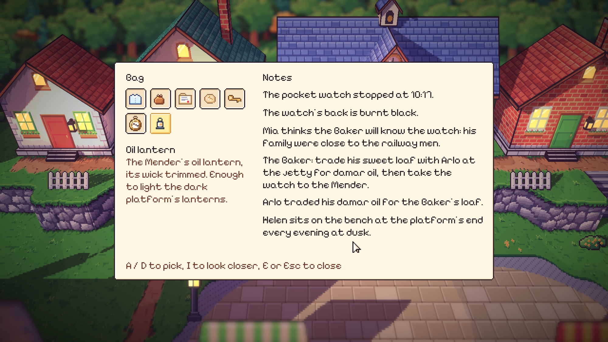
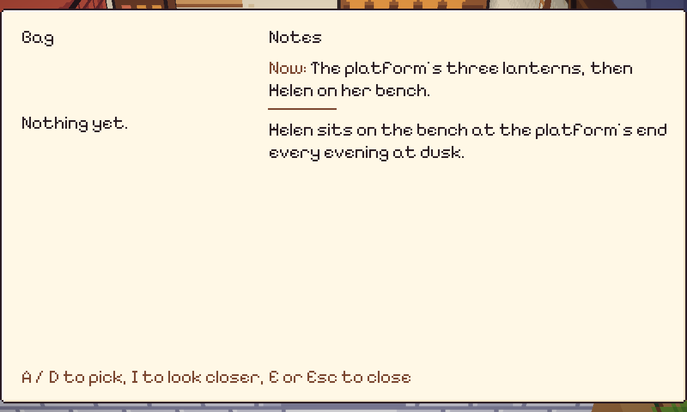
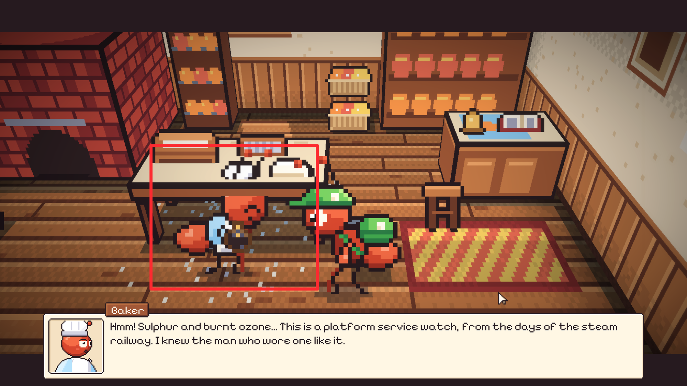
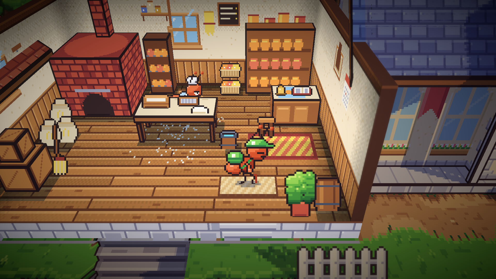

# 56. Tugas Kurir di Tas, dan Baker di Balik Meja

**Tanggal:** 2026-10-21

## Tujuan

Pengguna memainkan Night 1 dan terjebak di senja hari. Tas berisi lentera minyak dari Mender, dan catatan terakhir
berbunyi "Helen sits on the bench at the platform's end every evening at dusk." Pengguna bertanya apakah petunjuknya
terlalu pendek atau mereka yang kurang jago.

Pengguna juga melaporkan bahwa NPC terlihat menembus meja dan seperti menaruh sesuatu di tanah. Di tangkapan layarnya,
Baker berdiri di depan meja adonan dengan tubuh menutupi kaki meja.

## Penyebab

### Petunjuk yang hilang

Langkah berikutnya adalah menyalakan tiga lentera di peron, lalu duduk bersama Helen. Langkah itu hanya disebut sekali,
lewat toast "The platform's three lanterns, then Helen on her bench." yang hilang setelah empat detik. Catatan di tas
tidak menyebutnya, dan satu-satunya petunjuk lain tersembunyi di deskripsi lentera minyak. Jadi ini bukan soal skill:
pemain yang melewatkan toast itu tidak punya apa-apa lagi untuk dipegang.

### Baker menguleni lantai

Di ronde paginya, Baker menguleni adonan di titik 6 px di depan meja, menghadap ke samping. Semut lebih pendek dari meja,
jadi tangannya bekerja di bawah daun meja, kira-kira setinggi lantai. Dari kamera, ia terlihat berdiri di dalam meja
dan menguleni tanah.

## Yang dikerjakan

### Tugas kurir (`Core/Game.cs`, `Core/Chapter.cs`, `UI/Bag.cs`)

- `Hint()` sekarang juga menyimpan teksnya sebagai `Game.Errand`, tugas kurir saat ini.
- Tas menampilkan tugas itu paling atas di Notes, dengan awalan "Now:" dan garis pendek di bawahnya, sampai petunjuk
  berikutnya menggantikannya. Tugas dikosongkan di awal setiap bab.
- Petunjuk cara bermain ("Click to walk...", "Press E...") memakai `Tip()` yang baru, jadi tetap hanya toast dan tidak
  menjadi tugas.

Ini satu baris di catatan Satria, bukan penanda atau panah, jadi pilar "tanpa penanda misi" tetap terjaga. Keputusannya
dicatat di `GAME-CONTEXT.md`.

### Baker di balik meja (`Core/Places.cs`)

Titik menguleni dipindah ke belakang meja adonan, di lantai antara meja dan rak. Meja sekarang menutupi kaki Baker, dan
tangannya bekerja di atas baskom di daun meja, seperti Marlow di balik meja kasirnya. Titik bicara Baker dipindah ke
depan meja, jadi kurir tetap menyapanya dari sisi toko.

## Yang belum

Masalah "menaruh sesuatu di tanah" lebih luas dari Baker. Pose `lift` dipakai 26 kali di ronde warga: warga mengangkat
paket di satu titik, membawanya, menaruhnya di titik lain, lalu paket itu lenyap saat mereka berjalan pergi, dan muncul
lagi dari udara di titik ambil. Ini dibahas bersama pertanyaan pengguna soal dunia yang terasa sepi dan malam yang
terasa membosankan, sebelum dikerjakan.

## Cara dicek

- Di editor: tas menampilkan "Now: The platform's three lanterns, then Helen on her bench." di atas catatan.
- Di editor: Baker berjalan ke balik meja dan menguleni di atas baskom.
- Semua 17 tes PlayMode lulus.
- Build macOS dan Windows dibuat ulang.

## Commit

- `e593cfc` feat(ui): keep the courier's errand at the top of the bag's notes
- `bf26bbf` fix(bakery): knead behind the dough table, not in front of it
- `c40acef` docs(context): record the courier's errand in the bag
