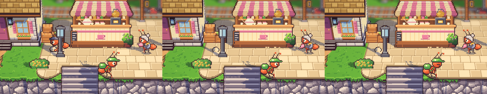
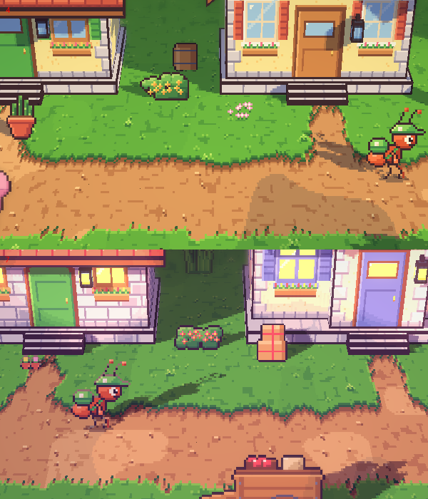
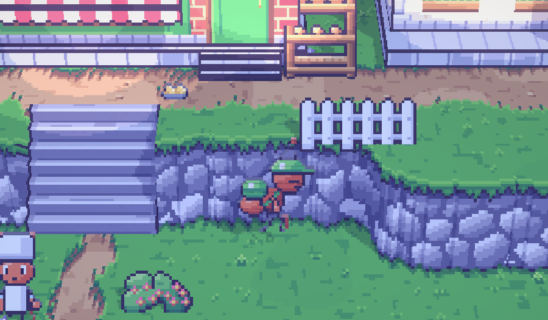

# 57. Muatan Warga Tetap Tergeletak

**Tanggal:** 2026-10-21

## Tujuan

Pengguna melaporkan bahwa semua NPC terlihat seperti "menaruh sesuatu di tanah". Ini masalah yang dicatat di "Yang
belum" entri 56, dan ternyata dialami semua warga yang membawa barang, bukan hanya Baker.

## Penyebab

Pose `lift` menggambar muatan di kaki semut hanya selama pose itu berjalan. Warga yang menaruh muatan di satu titik lalu
berjalan pergi tanpa membawanya membuat muatan itu hilang begitu saja, seolah ditanam ke tanah. Di putaran berikutnya
muatan yang sama muncul lagi dari udara di titik ambil.

Ada 26 titik `lift` di ronde warga. Titik ambil sebagian besar sudah berdiri di samping properti yang masuk akal
(peti di dermaga, karung di halaman stasiun, pohon di kebun), jadi yang terasa salah adalah titik taruh.

## Yang dikerjakan

### Muatan sebagai gambar sendiri (`ArtSource/chars.js`, `ArtSource/export-cast.js`)

`CH.ground(id)` menggambar muatan seorang warga sendirian, di sel 40 px yang sama dengan lembar karakternya, tepat di
posisi pose `lift` menaruhnya. Ekspor cast menulisnya ke `chars/loads/<id>.png` untuk setiap warga yang punya pose
`lift`: karung porter, keranjang roti Baker, peti sayur Mia, surat Pip, pot florist, keranjang apel, ember herder, peti
ikan, karung garam, dan lainnya.

### Menaruh dan mengambil (`Actors/Ant.cs`, `Actors/Villager.cs`)

- `Ant.SetDown(side)` meninggalkan muatan itu tergeletak di tempat pose `lift` menaruhnya, dicerminkan dengan cara yang
  sama seperti tubuhnya, sedikit di belakang semut yang berdiri di titik yang sama.
- Warga yang meninggalkan titik `lift` tanpa membawa apa-apa meninggalkan muatannya di sana, sekali per titik, jadi
  porter tidak menumpuk karung tanpa batas.
- Warga yang mengangkat lagi di titik yang sama membawa muatan yang tergeletak itu.

### Titik taruh yang masuk akal (`Core/Places.cs`)

Begitu muatan tetap terlihat, beberapa titik taruh ternyata jatuh di tempat yang aneh:

- Porter menaruh karung di kaki tiang lampu. Sekarang ia menaruhnya di depan tumpukan peti Helen.
- Salter menaruh karung garam di tengah jalan. Sekarang karungnya bergabung dengan tumpukan di depan gudang garam.
- Baker menaruh keranjang malamnya di puncak tangga. Sekarang keranjangnya menunggu di samping tangga pintu toko roti.
- Pip meninggalkan surat di jalan tanah, jauh di bawah pintu. Sekarang ia berjongkok di anak tangga pintu tetangga dan
  menyelipkan surat ke bawah pintu, jadi suratnya memang hilang dari pandangan.
- Pot florist di sore hari sekarang ditaruh di anak tangga rumahnya sendiri.

## Cara dicek

- Di editor, setiap tempat dengan titik taruh dijalankan delapan kali lebih cepat, lalu difoto: stasiun, pantai, alun-
  alun pagi dan sore, sisi timur, dan toko roti. Setiap muatan tetap tergeletak setelah warganya pergi dan tidak jatuh
  ke dalam properti.
- Setiap titik baru dicek bisa dicapai lewat peta jalan.
- Semua 17 tes PlayMode lulus.

## Commit

- `67b3846` fix(villagers): leave a set-down load lying where it was put
