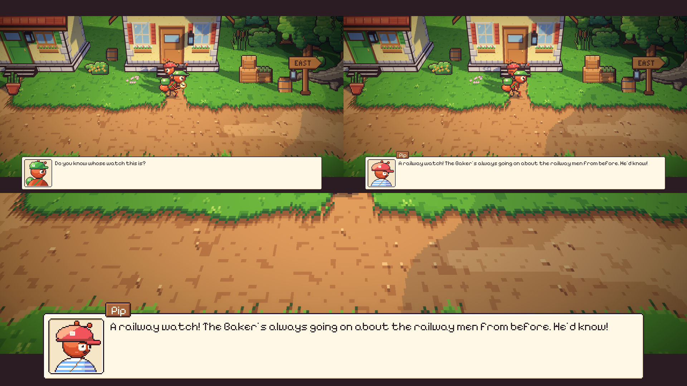
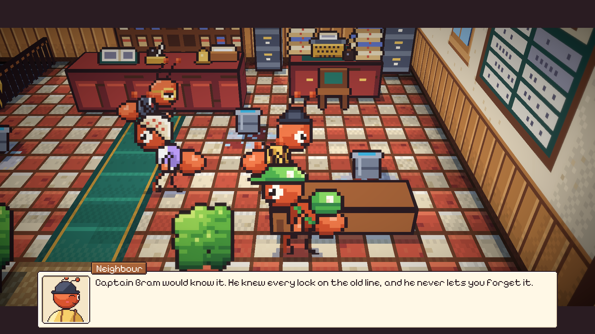
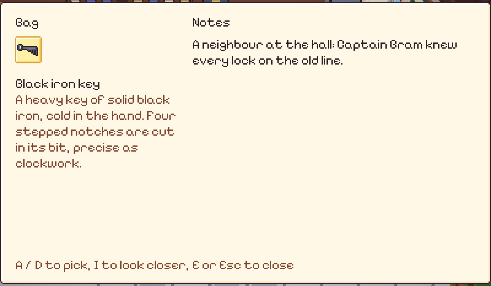

# 58. Bertanya Keliling dengan Keepsake

**Tanggal:** 2026-10-21

## Tujuan

Pengguna merasa setiap malam membosankan dan mirip satu sama lain. Dari empat ide yang ditawarkan, pengguna memilih
semuanya. Entri ini mengerjakan ide pertama: malam sebagai penyelidikan. Petunjuk tidak lagi menyebut siapa yang harus
didatangi; kurir menunjukkan keepsake ke warga, dan jalan malam itu ditemukan dari jawaban mereka.

## Penyebab

Di pagi setiap malam, petunjuknya berbunyi "Someone in the square might know...". Tapi hanya satu atau dua warga yang
punya adegan untuk keepsake itu. Warga lain menjawab dengan kalimat biasa mereka, yang tidak ada hubungannya dengan
jam saku atau kunci di tas kurir. Jadi bertanya keliling terasa seperti menebak, bukan menyelidiki.

Dua petunjuk juga menyebut nama sebelum ada tokoh yang menyebutnya: "Captain Bram knows the old iron of the line" di
Night 4 setelah Valdo, dan "Arlo knows the coast" di Night 3 setelah Leo, padahal Leo tidak menyebut Arlo sama sekali.

## Yang dikerjakan

### Menunjukkan keepsake (`Chapters/NightChapter.cs`)

- Di siang hari, saat kurir pertama kali mendatangi seorang warga sambil membawa keepsake malam itu, Satria
  menunjukkannya dan bertanya (`Asking`), lalu warga itu menjawab dengan suaranya sendiri (`Reactions`).
- Jawaban yang berisi petunjuk masuk ke Notes di tas. Setelah itu warga kembali ke kalimat biasa mereka.
- Tokoh yang punya adegan untuk malam itu, dan pemilik keepsake-nya, tetap memakai adegan mereka sendiri, jadi cerita
  tidak berubah.

### Jawaban warga (`Chapters/Night1.cs` sampai `Night5.cs`)

Setiap malam punya sekitar enam belas jawaban. Sebagian menunjuk ke petunjuk malam itu lewat apa yang mereka tahu,
sebagian hanya kesan, ingatan, atau candaan:

- Night 1, jam saku: Pip, Sam, dan pembeli di pasar menunjuk ke Baker dan keluarganya yang dekat dengan orang kereta.
  Porter menunjuk ke Mender.
- Night 2, kelinci: Sam menunjuk ke Mia, pembeli mengenali jahitan Ratih, dan Nora bercerita bahwa Pip duduk di
  tangganya.
- Night 3, kamera: nelayan menunjuk ke Leo yang masih memanggil Theo setiap pagi. Pekerja garam dan Arlo sendiri
  menunjuk ke tali Arlo.
- Night 4, kunci: para tetangga di balai, porter, dan Leo menunjuk ke Captain Bram. Mender mengenali kunci itu sebagai
  kunci lemari besi tahan api.
- Night 5, sepatu: Mia, Pip, dan Sam menunjuk ke pelari terbaik pulau. Baker menunjuk ke anak penjualnya, dan Gardener
  menyebut bukit Leo.

Night 6 dan 7 bukan pencarian pemilik, jadi tidak punya jawaban.

### Petunjuk (`Chapters/Night1.cs` sampai `Night5.cs`)

- Petunjuk pagi menambahkan "Show it round." agar pemain tahu caranya.
- Petunjuk Night 4 setelah Valdo menjadi "Valdo only wants it for himself. Someone who knows old railway iron, then."
- Petunjuk Night 3 setelah Leo tidak lagi menyebut Arlo. Tebing yang terlalu licin kini membuat Satria berkata ia butuh
  tali dan seseorang yang tahu pantai itu.

### Warga yang menunggu kurir (`Actors/Villager.cs`, `Core/Place.cs`)

Saat dicoba, kurir sering tidak sampai ke warga yang sedang berkeliling. Pip berjalan secepat kurir dan hanya berhenti
dua detik di setiap pintu, jadi kurir tiba saat Pip sudah pergi, lalu berbicara dari jauh atau tidak pernah sampai.

- Warga yang didatangi kurir menahan titik tempat ia berada, atau titik berikutnya, selama beberapa detik.
- Kurir mengikuti warga yang sudah berpindah sejak ia berangkat, bukan hanya warga yang masih berjalan saat ia tiba.

## Cara dicek

- Night 1 pagi di alun-alun: kurir mendatangi Pip, menunjukkan jam saku, Pip menunjuk ke Baker, dan catatannya masuk ke
  tas.
- Night 4 pagi di balai: tetangga menunjuk ke Captain Bram.
- Semua 17 tes PlayMode lulus.

## Commit

- `d10e26e` fix(villagers): wait for the courier coming to talk
- `e85d0ee` feat(nights): show the night's keepsake round the village
- `3049582` docs(context): record asking round with the night's keepsake
