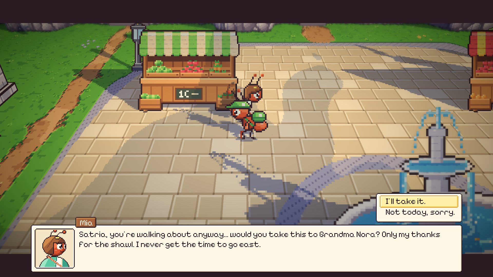
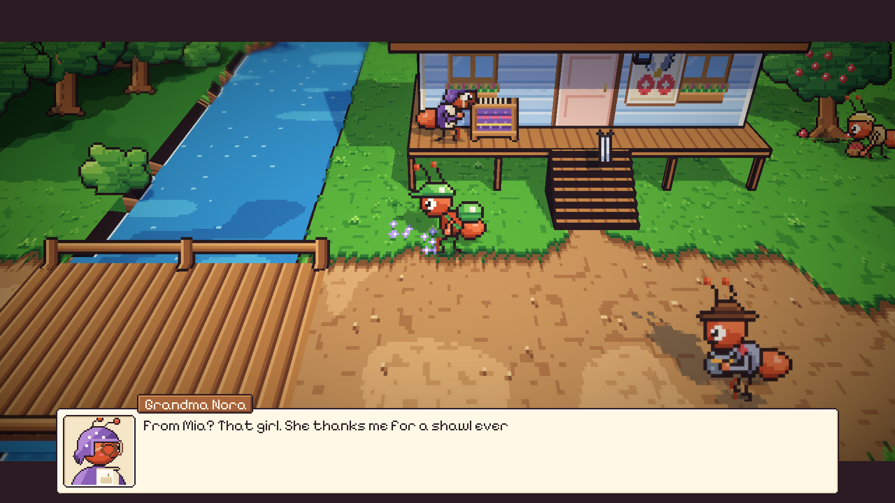
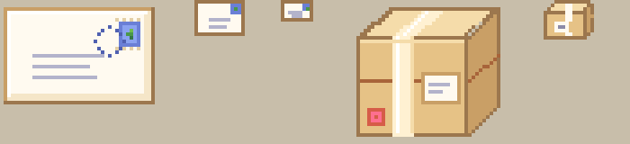

# 59. Titipan Warga

**Tanggal:** 2026-10-21

## Tujuan

Ini pilihan kedua dari empat pilihan pengguna untuk membuat malam-malam tidak monoton. Satria memang kurir, tapi di
siang hari ia hampir tidak pernah mengantar apa-apa selain kenang-kenangan malam itu. Sekarang warga desa menitipkan surat
dan paket kecil kepadanya.

## Yang dikerjakan

### Daftar titipan (`Core/Post.cs`)

Ada sepuluh titipan, dua untuk setiap malam dari Night 1 sampai Night 5. Setiap titipan punya pengirim, penerima, kalimat
saat menitip, dan kalimat terima kasih:

| Malam | Pengirim → penerima | Titipan |
|-------|---------------------|---------|
| 1 | Mia → Grandma Nora | surat terima kasih untuk syal |
| 1 | porter → Helen | paket teh |
| 2 | Baker → Sam | roti |
| 2 | florist → Gardener | catatan soal benih |
| 3 | fisher → Baker | ikan asap |
| 3 | Nora → Mia | rajutan Nora |
| 4 | Helen → Bram | catatan untuk sang Kapten |
| 4 | farmhand → herder | karung jerami kering |
| 5 | Mender → Arlo | jarum jaring |
| 5 | salter → florist | sejumput garam laut |

Titipan tidak pernah menjadi syarat cerita, tidak menunjuk pemilik kenang-kenangan malam itu, dan tidak disebut di
petunjuk. Isinya hanya kehidupan desa.

### Menitip dan mengantar (`Chapters/NightChapter.cs`)

- Saat kurir pertama kali bicara dengan pengirim di siang hari, pengirim menawarkan titipannya. Pemain memilih "I'll
  take it." atau "Not today, sorry.". Tawaran yang ditolak tidak diulang.
- Titipan masuk ke tas seperti kenang-kenangan, dengan nama dan satu sisi yang bisa dilihat.
- Saat bicara dengan penerima, kurir menyerahkannya dalam satu adegan pendek: Satria memberi, penerima menerima, lalu
  berterima kasih dengan suaranya sendiri.
- Titipan yang sampai diingat lintas bab sebagai `delivered_<id>`, supaya desa bisa mengingatnya nanti.
- Urutan percakapan siang sekarang: rumah, reaksi kenang-kenangan, titipan, lalu obrolan biasa jika belum ada yang
  terjadi.

### Gambar (`ArtSource/interiors.js`, `Core/Keepsakes.cs`)

Ada amplop desa baru dalam tiga ukuran, dengan perangko daun, cap pos, dan garis alamat. Paket memakai gambar paket yang
sudah ada. `Keepsake.Art` membuat titipan meminjam gambar itu tanpa menggandakan berkas.

Keputusannya dicatat di `GAME-CONTEXT.md`.

## Cara dicek

- Di editor: Mia menawarkan suratnya dengan dua pilihan, surat masuk ke tas, lalu Nora menerimanya dan surat keluar dari
  tas.
- Tes `Night1PlaysThrough` sekarang juga mengambil surat Mia dan mengantarnya ke Nora sebelum ke stasiun.
- Semua 17 tes PlayMode lulus.

## Commit

- `cd0f40e` feat(post): carry the villagers' letters and parcels
- `7763b4c` docs(context): record the villagers' optional post
