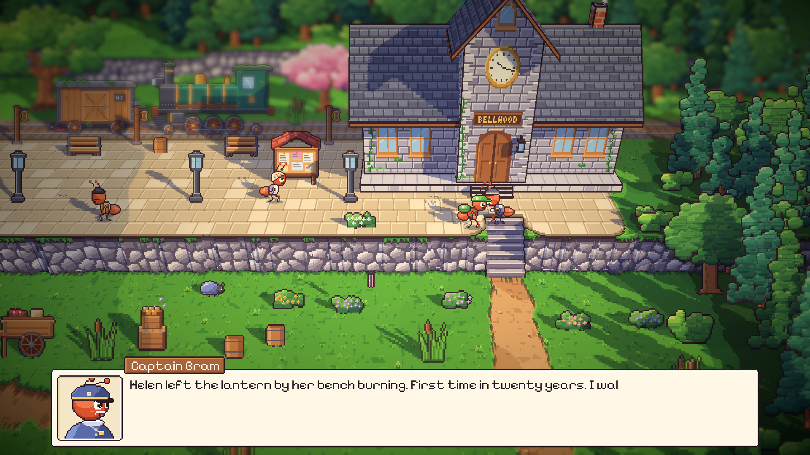

# 60. Desa yang Ingat

**Tanggal:** 2026-10-21

## Tujuan

Ini pilihan ketiga dari empat pilihan pengguna untuk membuat malam-malam tidak monoton. Sebelumnya desa tidak pernah
membicarakan malam yang sudah lewat. Helen mendapat jam Marcus kembali, tapi besoknya semua warga mengucapkan kalimat
yang sama seperti sebelumnya. Sekarang desa ingat.

## Yang dikerjakan

### Kabar hari kemarin (`Core/Gossip.cs`, `Core/Chapter.cs`)

- Sehari setelah setiap penyerahan, lima atau enam warga punya satu kalimat tentangnya dengan suara mereka sendiri:
  - Night 2: Helen bersenandung saat membeli tepung subuh-subuh, dan Bram melihat lentera di bangkunya menyala.
  - Night 3: Pip membeli dua roti, satu untuk Mochi, dan Mia terbangun di kursi karena Pip tidur semalaman.
  - Night 4: Theo merekam perahu di dermaga lagi dan membeli roti untuk pertama kalinya dalam lima tahun.
  - Night 5: Sam membuka balai sepuluh menit terlambat, dan alun-alun bingung harus bagaimana.
  - Night 6 dan 7: Leo berlari sekencang-kencangnya dan minta Sam mencatat waktunya.
- Titipan yang sampai (entri 59) diingat oleh pengirim atau penerimanya sehari atau dua hari setelahnya: surat Mia
  ditempel di alat tenun Nora, ikan asap jadi pai, dan seterusnya.
- Setiap kalimat diucapkan sekali saja, saat kurir pertama kali bicara dengan warga itu di harinya, sebelum kalimat
  mereka sendiri. Kabar yang sudah basi tidak diucapkan lagi.
- Warga yang dibutuhkan cerita malam itu tidak diberi kabar, jadi petunjuk cerita tidak tertunda.

### Perubahan yang terlihat (`Core/Places.cs`, `Core/PlaceDef.cs`, `Actors/Villager.cs`)

- Mulai Night 3, Pip selalu membawa Mochi saat istirahat siang di taman bermain, saat senja, dan di Day 8. Tidak perlu
  gambar baru: `Person.Holds` menaruh gambar kecil kenang-kenangan itu di tangan warga.
- Kalimat yang tidak benar lagi setelah penyerahan diganti mulai malam berikutnya:
  - Theo tidak lagi berkata "The darkroom's locked" setelah Night 3.
  - Leo tidak lagi berkata "Don't time me" setelah Night 5.
  - Pip tidak lagi bertanya apakah kurir takut petir setelah Night 2.

Keputusannya dicatat di `GAME-CONTEXT.md`.

## Cara dicek

- Di editor: Bram mengucapkan kabar lentera Helen di pagi Night 2, lalu kembali ke kalimatnya sendiri.
- Di editor: Pip membawa Mochi di taman bermain pada siang Night 3.
- Tes baru `TheVillageRemembersOnce` mengecek tiga hal: kabar titipan hanya muncul jika titipannya sampai, setiap kabar
  diucapkan sekali, dan kabar lama tidak diucapkan lagi.
- Semua 18 tes PlayMode lulus.

## Commit

- `dd27866` feat(village): remember the nights gone by and the post carried
- `b0e1a0f` docs(context): record the village remembering its nights
