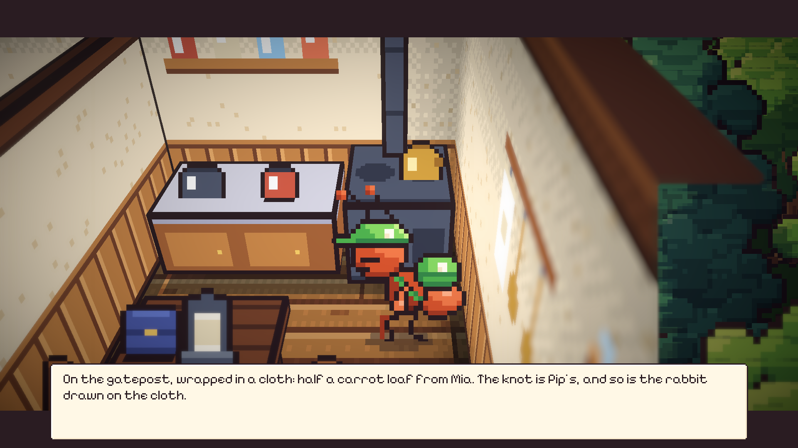
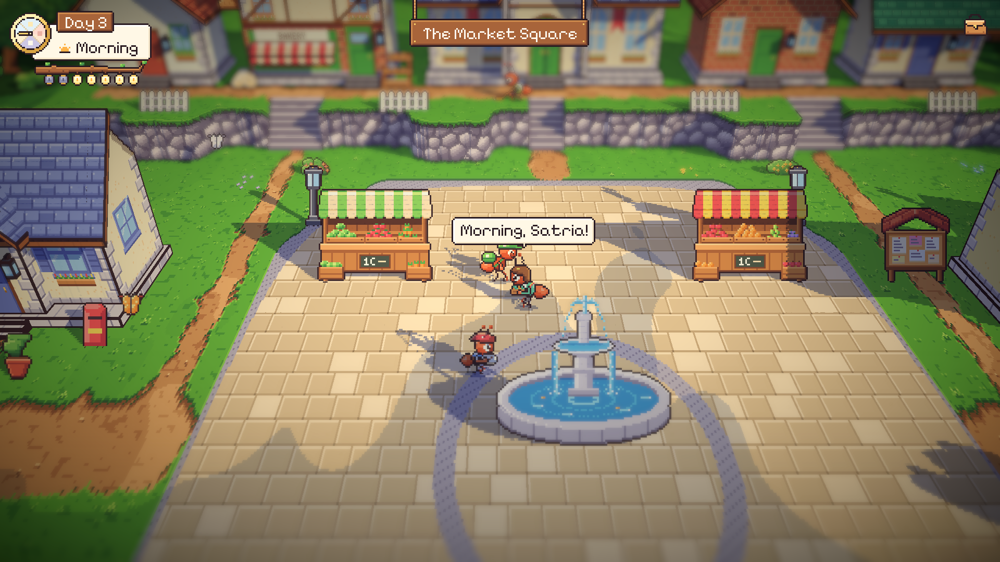

# 61. Pagi yang Mengalir dan Sapaan di Jalan

**Tanggal:** 2026-10-21

## Tujuan

Ini pilihan terakhir dari empat pilihan pengguna untuk membuat malam-malam tidak monoton: tempo dan kehidupan kecil di
jalan. Rutinitas malam di rumah sudah jadi satu montase sejak Night 2, tapi masih ada yang terasa berulang:

- Setiap pagi pemain harus berjalan sendiri ke tungku.
- Teksnya selalu "Sweet tea, too hot, drunk anyway."
- Tas tetap berkata "Now: Tea's on the stove." sampai ada petunjuk lain.
- Kalimat di keset dan kalimat montase sama persis setiap malam.

## Yang dikerjakan

### Pagi yang mengalir (`Chapters/NightChapter.cs`, `Chapters/Night1.cs` sampai `Night6.cs`)

- Pada Night 2 sampai 5, pagi berlanjut langsung dari bangun tidur. Satria berjalan ke tungku dan minum teh, lalu
  menemukan sarapan yang ditinggalkan seseorang setelah penyerahan kemarin:
  - Night 2: daun teh dari Helen, dengan catatan "With sugar. H."
  - Night 3: setengah roti wortel dari Mia, diikat dengan simpul Pip.
  - Night 4: ikan asap dan setangkai mint Daniel dari Theo.
  - Night 5: roti biji dari Baker, dengan catatan Sam: "Breakfast. Eaten properly. Sitting down."
- Ini mewujudkan keputusan 129 yang dulu belum dibuat, yaitu sarapan dari pemberian desa.
- Night 1, 6, dan 7 tetap meminta pemain menekan tungku sendiri, karena di malam-malam itu rutinitasnya dimainkan penuh.
- Setelah teh diminum, tugas di tas pindah ke tempat pertama hari itu, misalnya "The coast, and a door that's been
  chained for five years.", dan tidak lagi tertahan di tungku.
- Kalimat montase berbeda setiap malam, misalnya "Mat, table, jar, coil. My feet know the way before I do." Kalimat
  keset hanya muncul di malam pertama.
- Kotak bicara ditutup sebelum Satria berjalan ke tungku, jadi kalimat pagi tidak ikut terbawa saat ia berjalan.

### Sapaan di jalan (`UI/Hud.cs`, `Actors/Villager.cs`, `ArtSource/export-cast.js`)

- Warga yang menoleh saat kurir lewat kadang mengucapkan salam pendek dalam balon kertas kecil di atas kepalanya.
- Salamnya mengikuti waktu: "Morning, Satria!", "Warm one, eh?", "Home before dark, mind.", "Still up, courier?".
  Anak-anak punya salam sendiri ("Race you!", "Got any post?"), dan di hari hujan ada "Mind the puddles!".
- Balonnya dibuat dari kertas yang sama dengan gelembung emosi: kotak sembilan potong dan ekor kecil di tengah bawah.
- Paling banyak dua balon tampil sekaligus, dan hanya saat kurir bebas berjalan, tidak di tengah adegan.

### Hewan

Tidak ditambah. Serangga seukuran semut sudah ada di setiap tempat luar ruangan: kupu-kupu dan capung terbang, kunang-
kunang di malam hari, kepik, siput, dan kumbang merayap, ditambah kawanan kutu daun milik penggembala dan kumbang penarik
gerobak (keputusan 94 dan 162).

Keputusannya dicatat di `GAME-CONTEXT.md`.

## Cara dicek

- Di editor: montase Night 3 dimainkan dari pintu sampai pagi. Satria berjalan ke tungku, sarapan dari Mia muncul, lalu
  tugas di tas berubah ke pantai.
- Di editor: balon sapaan tampil di atas kepala warga di alun-alun.
- `RoutineTest` sekarang mengecek bahwa teh sudah diminum di pagi Night 2 tanpa menekan tungku.
- Semua 18 tes PlayMode lulus.

## Commit

- `1d9725a` feat(nights): take later mornings' tea with the village's breakfast
- `3a4ce31` feat(villagers): say hello as the courier passes
- `a913605` docs(context): record the later mornings and the hellos in passing
