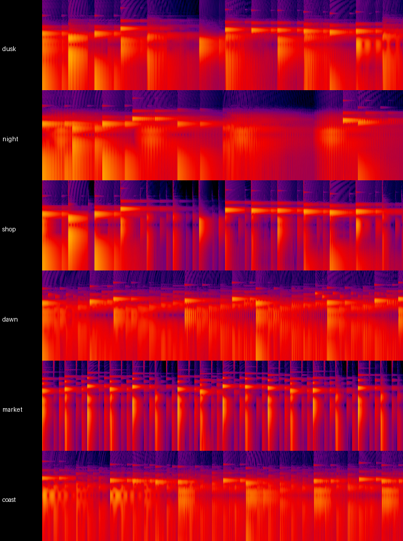
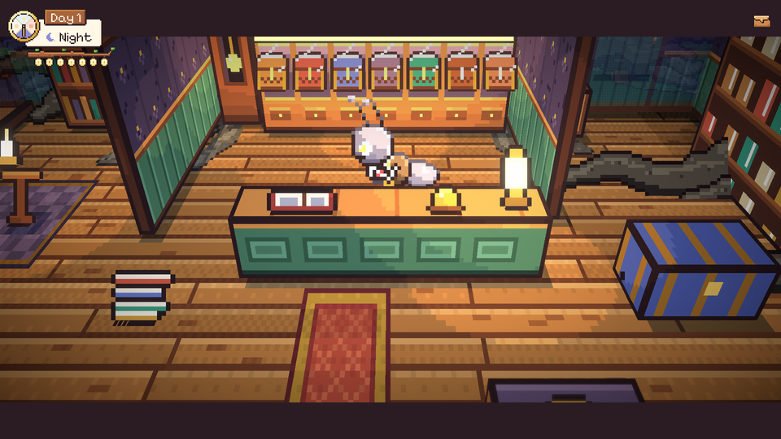
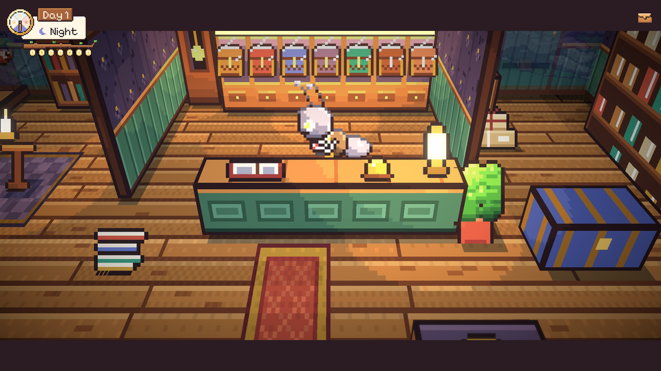
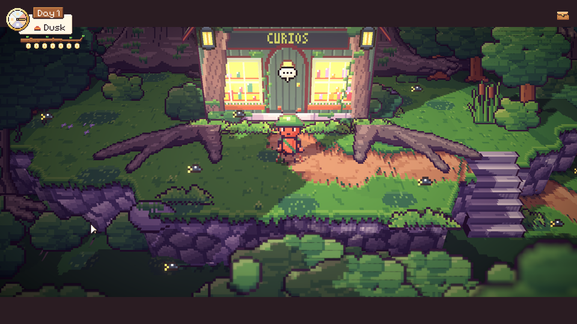
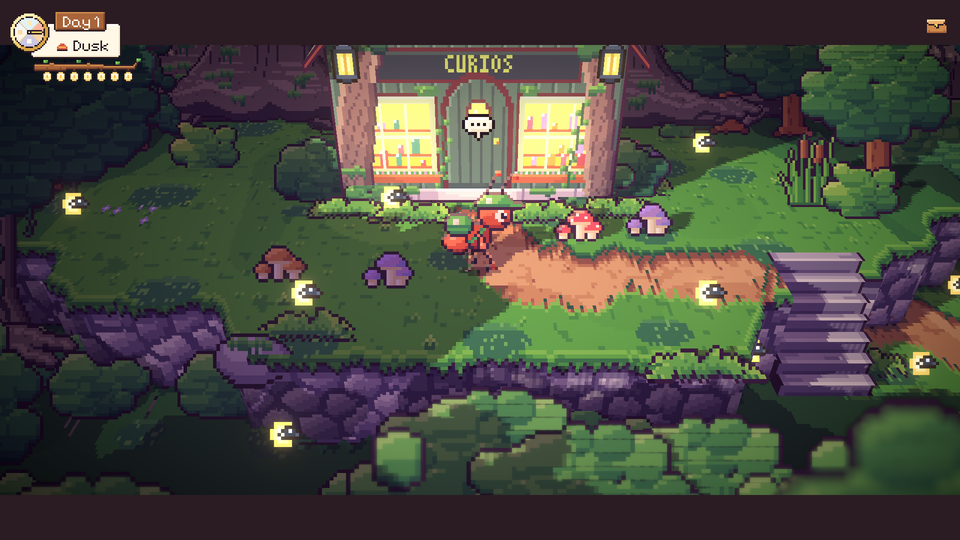

# 62. Musik yang Berbeda-beda dan Lantai Toko yang Bersih

**Tanggal:** 2026-10-21

## Tujuan

Dari play-test build macOS, pengguna menemukan tiga hal:

- Musik terasa sama saja walaupun sudah diganti per tempat dan per waktu.
- Di toko Marlow ada noda abu-abu gelap di lantai, dan ada celah di ujung kanan meja kasir.
- Di depan toko, dua akar besar yang melebar di kiri dan kanan pintu terlihat janggal.

## Yang dikerjakan

### Setiap lagu punya tempo, birama, dan iringan sendiri (`ArtSource/audio.js`, `ArtSource/export-sound.js`)

Penyebabnya: semua lagu memakai tempo 69 bpm, birama 3/4, dan iringan piano yang sama dengan lagu senja. Hanya melodi
dan alat musik utamanya yang berbeda. Lagu siang juga 7 dB lebih pelan dari yang lain, jadi hampir tidak terdengar.

Sekarang setiap lagu punya tempo sendiri, tetap dalam batas GDD yaitu 60 sampai 80 bpm, beserta iringannya sendiri:

| Lagu | Tempo dan birama | Iringan |
|------|------------------|---------|
| Pasar (siang) | 80 bpm, 4/4 | Bas gitar di ketukan 1 dan 3, genjrengan di 2 dan 4, shaker di setiap seperdelapan |
| Pantai | 80 bpm, 6/8 | Gitar mengalun naik-turun setiap seperdelapan, bas di dua ketukan, cello di bawahnya |
| Toko Marlow | 69 bpm, 3/4 | Waltz jam mekanik: bas petik, akor pendek, dan tik-tok bandul di setiap ketukan |
| Pagi | 76 bpm, 3/4 | Piano bergulir naik menyusuri akor, sesekali dua nada burung |
| Rumah | 60 bpm, 3/4 | Akor piano dipecah naik-turun seperti nina bobo |
| Kenangan | 60 bpm, 3/4 | Akor yang mengembang pelan |
| Malam (baru) | 60 bpm, 3/4 | Cello rendah di nada dasar, kotak musik hanya memainkan motif 10:17, bintang celesta |

- Malam sekarang punya lagunya sendiri. Sebelumnya malam memutar lagu senja.
- Semua lagu diekspor dengan kekerasan yang sama (−38 dB RMS, sama dengan lagu senja).

### Lantai toko yang bersih (`ArtSource/inside.js`)

Noda gelap di lantai berasal dari dua sumber:

- Akar di lantai yang memang digambar di `paint()` toko. Akar ini dihapus.
- Pohon purba hutan grove yang berdiri di belakang dan di samping toko. Game menegakkan setiap decal di baris
  terbawah gambarnya, dan pada pohon purba baris itu adalah ujung akarnya. Akibatnya akar pohon di luar ikut berdiri di
  lantai toko. Sebelumnya ruangan hanya membuang decal yang batangnya berdiri di dalam ruangan. Sekarang ruangan
  membuang setiap decal yang berdiri di kedalaman ruangan dan gambarnya melintas ke dalamnya. Lebar gambar diukur dari
  piksel yang benar-benar tergambar.

Celah di ujung kanan meja kasir ditutup dengan pot palem. Di depan peti-peti gudang ada tumpukan paket bertali yang
menunggu diantar.

### Depan pintu toko (`ArtSource/village-west.js`, `ArtSource/areas.js`)

Dua akar yang melebar di depan pintu adalah gambar di model toko itu sendiri. Gambarnya dihapus. Di kiri dan kanan
pintu sekarang tumbuh jamur di rumput, di bawah bayangan pohon.

Keputusannya dicatat di `GAME-CONTEXT.md`.

## Cara dicek

- Spektrogram enam lagu menunjukkan pola yang berbeda: pasar berdenyut rapat dan rata, malam jarang dan panjang, pagi
  bergulir terus.
- Di editor: malam di grove memutar `music_night`, dan siang di alun-alun memutar `music_market`.
- Semua lagu terukur −38 dB rata-rata.
- Di editor: lantai toko bersih dari kedua noda, dan pintu toko bersih dari akar.
- Walk mask toko hanya berubah di dua benda baru (354 piksel).
- Semua 18 tes PlayMode lulus.

## Commit

- `8546d5d` fix(shop): clear the roots off the shop's floor and doorstep
- `3851465` feat(music): give each theme its own tempo, bar and band, and the night its own
- `3426b68` docs(context): record the themes kept apart and the shop's cleared floor
