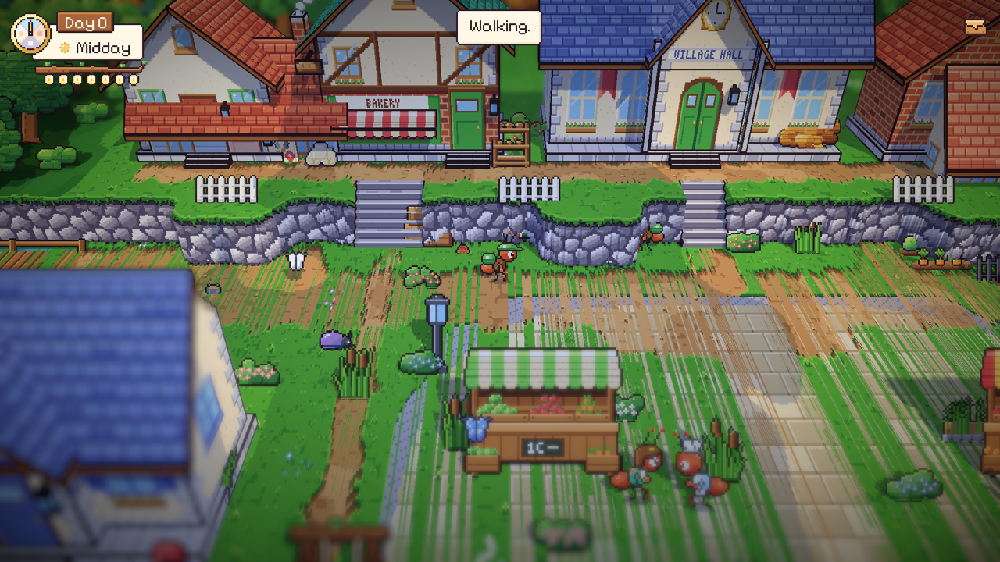
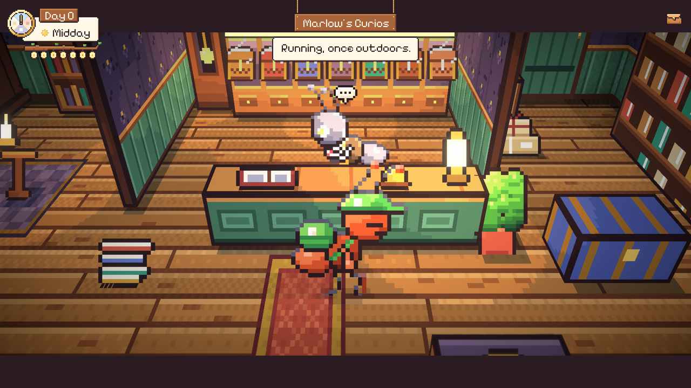

# 63. Shift sebagai Sakelar Lari

**Tanggal:** 2026-10-21

## Tujuan

Pengguna bertanya apakah perlu bar stamina supaya pemain tidak terus-menerus menahan Shift. Jawabannya tidak: tidak
ada timer yang berjalan dan tidak ada yang bisa terlewat (keputusan 132), jadi berlari terus tidak merugikan apa pun.
Bar stamina juga akan menjadi timer kecil di layar, padahal GDD berpilar "tanpa timer". Yang sebenarnya melelahkan
adalah menahan tombolnya, jadi pengguna meminta Shift cukup ditekan sekali, bukan ditahan.

## Yang dikerjakan (`Core/Controls.cs`, `Core/Place.cs`)

- Sekali tekan Shift menyalakan lari, tekan lagi kembali berjalan. Catatan kecil "Running." atau "Walking." muncul di
  atas layar.
- Pilihan itu diingat untuk sesi berikutnya (`PlayerPrefs`), jadi pemain yang suka berlari tidak perlu menekannya lagi
  setiap kali membuka game.
- Di dalam ruangan Satria selalu berjalan, karena ruangan hanya beberapa langkah lebarnya dan dilihat dari dekat. Kalau
  Shift ditekan di dalam, catatannya berkata "Running, once outdoors."
- Teks petunjuk di Prologue dan `README.md` diganti dari "hold Shift to run" menjadi "Shift to run or walk".

Keputusannya dicatat di `GAME-CONTEXT.md`.

## Cara dicek

- Di editor: di alun-alun, sekali tekan Shift membuat Satria berlari dan tetap berlari setelah tombol dilepas; tekan
  lagi, ia berjalan.
- Di editor: di toko Marlow dengan lari menyala, Satria berjalan saat digerakkan dengan A.
- Semua 18 tes PlayMode lulus.

## Commit

- `32117a5` feat(controls): switch between running and walking with a tap of Shift
- `60f331d` docs(context): record the pace as a switch and no stamina bar
