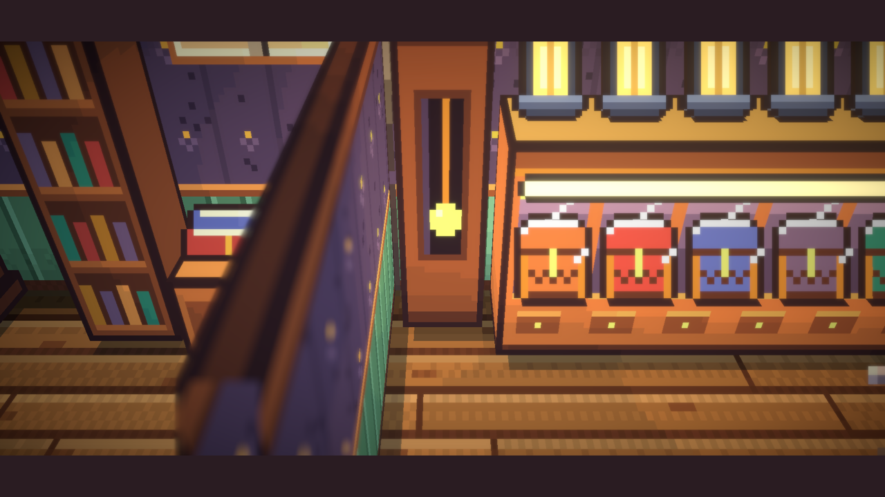
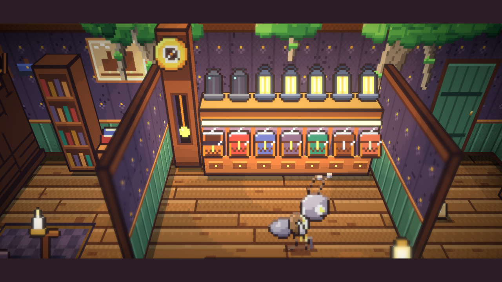
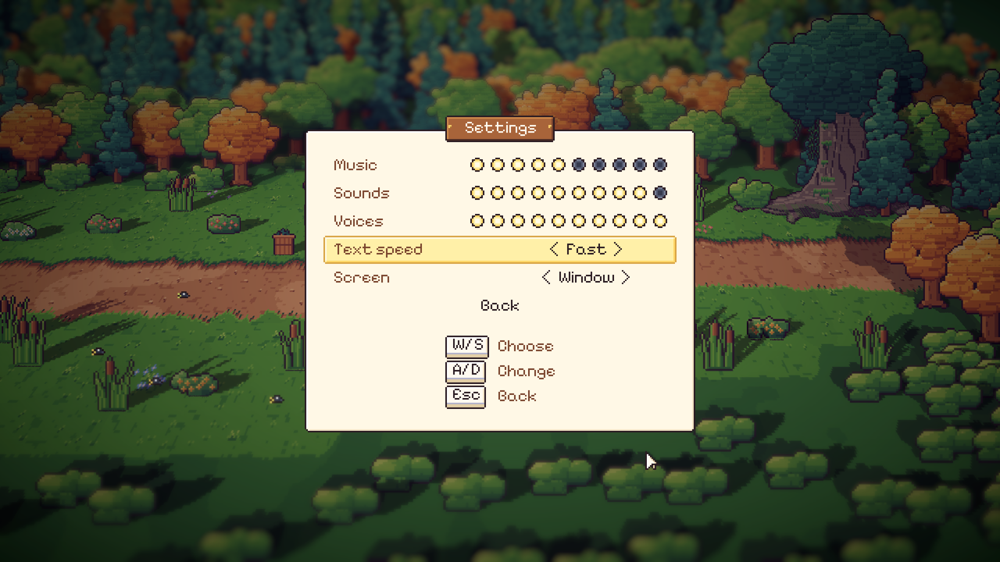

# 64. Halaman Pengaturan, Tombol Pengembang, dan Adegan Lentera

**Tanggal:** 2026-10-21

## Tujuan

Pengguna memilih dua langkah berikutnya: halaman pengaturan dan satu kali main penuh dari Prologue sampai Day 8. Untuk
main penuh itu pengguna bertanya apakah bisa ada kode curang khusus pengembangan, seperti F5 yang memajukan waktu.
Pengguna juga melaporkan adegan yang rusak: setelah keepsake diserahkan, potongan ke toko Marlow hanya memperbesar jam.

## Yang dikerjakan

### Adegan lentera padam (`Core/Main.cs`, `Core/Chapter.cs`)

- Penyebabnya: kamera melihat kaki jam, lalu mode sinematik mendekatkan kamera satu langkah lagi di atas zoom ruangan.
  Muka jam dan ketujuh lentera di atas lemari jadi terpotong di luar atas layar.
- `LookAt` sekarang punya pilihan `wide`: bilah hitam sinematik tetap ada, tapi kamera tidak mendekat satu langkah.
- Adegannya melihat ke antara jam dan lemari, jadi seluruh dinding belakang tampak: muka jam yang maju satu menit,
  lentera yang padam, dan kotaknya.

### Tombol pengembang (`Core/Controls.cs`, `Core/Main.cs`, `UI/Board.cs`, `UI/Talk.cs`)

Hanya ada di editor dan development build, tidak di build biasa:

| Tombol | Fungsi |
| --- | --- |
| F5 | Waktu maju (sudah ada sebelumnya) |
| F6 | Minigame yang tampil langsung dimenangkan |
| F7 (tahan) | Dialog langsung tampil penuh dan lanjut sendiri; kartu, halaman jurnal, dan reveal juga lanjut |
| F8 | Bab berikutnya dimulai, seperti saat bab selesai |

### Halaman pengaturan (`UI/Settings.cs`, `Core/Sound.cs`)

- Halamannya dari kertas, dengan papan kayu bertuliskan "Settings" yang dipaku di atasnya, seperti papan minigame.
  Halaman ini dibuka dari menu jeda (menggantikan Sound on/off) dan dari layar judul.
- Isinya:
  - volume musik, suara (efek, angin, ambience), dan suara karakter, masing-masing sepuluh pip;
  - kecepatan teks: Slow, Normal, atau Fast;
  - layar: Fullscreen atau Window.
- W / S atau mouse memilih baris, A / D atau klik mengubahnya, dan klik pada pip langsung mengatur volume. Esc atau Back
  menutup halaman.
- Semua pilihan disimpan untuk sesi berikutnya. Sound on/off yang lama tidak pernah disimpan.
- Pertanyaan terbuka soal kecepatan teks di `GAME-CONTEXT.md` sekarang terjawab.

Keputusannya dicatat di `GAME-CONTEXT.md`.

## Cara dicek

- Di editor: adegan lentera padam diputar pelan (`Time.timeScale`), dan dinding belakang tampak utuh.
- Di editor: F6 memenangkan minigame mesin jahit, F7 melewati pembukaan Prologue sampai Satria bisa berjalan, dan F8
  memulai Night 2.
- Di editor: pengaturan dibuka dari menu jeda; menurunkan musik ke lima pip membuat musik bervolume 0.25, klik pada pip
  kedelapan mengatur musik ke 8, dan Esc kembali ke permainan tanpa membuka menu jeda lagi.
- Semua 18 tes PlayMode lulus.

## Commit

- `cf8e56a` fix(handover): show the shop's whole back wall as the lantern goes out
- `b01966b` feat(dev): add cheat keys to win a minigame, skim talk and skip a chapter
- `232008e` feat(dev): let F7 move cards, journal pages and reveals on too
- `8c36407` feat(settings): add a settings page for volumes, text speed and the screen
- `48eec56` docs(context): record the settings page, the developer keys and the handover shot
