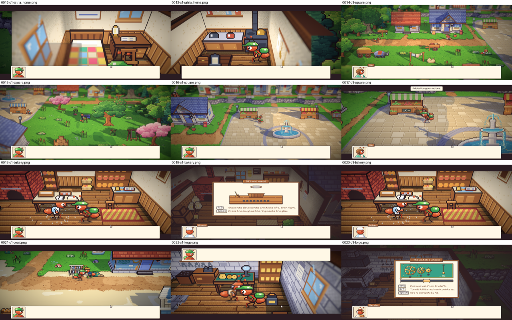
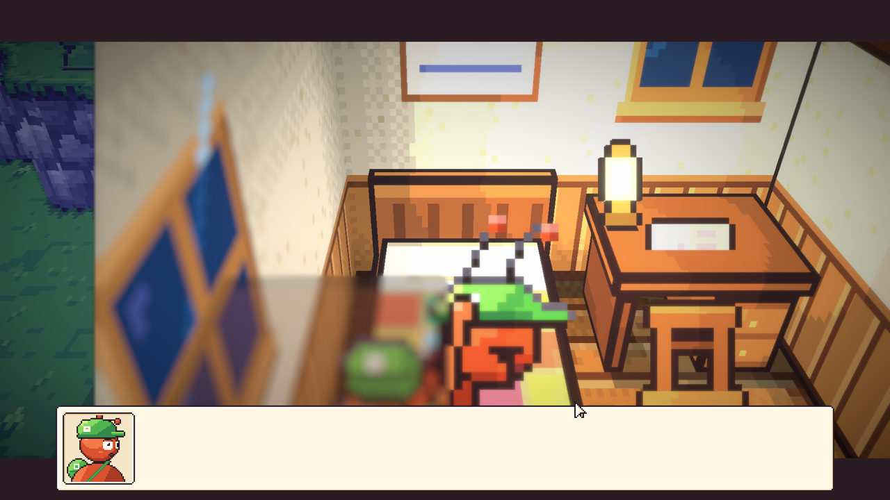
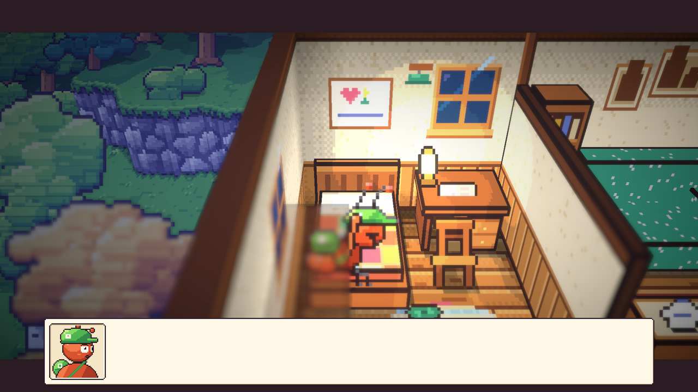
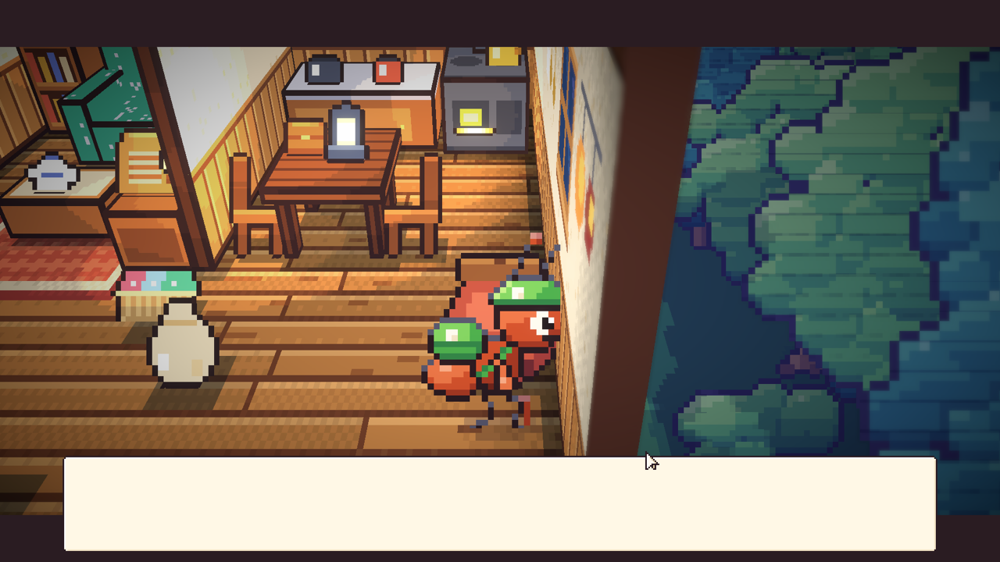

# 65. Main Penuh dan Kamera di Dalam Ruangan

**Tanggal:** 2026-10-21

## Tujuan

Ini pilihan kedua pengguna: satu kali main penuh dari Prologue sampai Day 8, untuk mencari yang tidak terlihat oleh tes.
Tes `PlaythroughTest` dan `NightsTest` sudah memainkan semua bab tanpa macet, tapi tes tidak bisa melihat gambar: apakah
setiap adegan dibingkai dengan baik, apakah seni tampil benar, dan apakah teksnya masuk akal.

## Cara main penuhnya

- Perekam sementara (tidak di-commit) ikut berjalan bersama semua tes PlayMode. Setiap kali kamera pindah ke bidikan
  baru atau baris dialog baru muncul di bidikan yang berbeda, layar ditangkap. Setiap baris dialog juga dicatat.
- Hasilnya 190 tangkapan dan 445 baris, dari Prologue, tujuh malam, sampai Epilogue. Tangkapannya disusun menjadi lembar
  berisi dua belas gambar supaya bisa diperiksa satu per satu.

## Yang ditemukan dan diperbaiki

### Adegan di dalam ruangan terlalu dekat (`Core/Main.cs`)

- Masalahnya sama dengan adegan lentera di entri 64: adegan sinematik mendekatkan kamera satu langkah di atas zoom
  ruangan, yang sudah dua kali lebih dekat dari luar (keputusan 109).
- Akibatnya di rumah Satria (bangun tidur, keset, tungku), studio Theo, dan ruang arsip, dinding yang kabur atau pepohonan
  di luar rumah memenuhi setengah layar.
- Sekarang adegan sinematik hanya mendekat di luar ruangan. Di dalam ruangan kamera tetap sedekat ruangan itu sendiri,
  dengan bilah hitamnya. Aturan ini juga mencakup adegan lentera, jadi pilihan `wide` dari entri 64 dihapus lagi.

### Tenggat Valdo (`Chapters/Prologue.cs`, `Chapters/Night2.cs`)

Tenggat Valdo adalah pagi Day 8, tapi dua kalimatnya bertentangan:

- Di Day 0 ia menyebut Day 8, lalu dalam kalimat yang sama berkata mereka tanda tangan "the day after tomorrow". Sekarang
  "within the week".
- Di Night 2 ia berkata investor datang "the day after tomorrow", padahal di Day 4 tidak ada yang datang. Sekarang "at the
  week's end".

### Yang diperiksa dan tidak bermasalah

- Semua bidikan di luar ruangan, di toko roti dan bengkel, dan di toko Marlow dibingkai dengan baik.
- Garis-garis di halaman bawah alun-alun (entri 63) ternyata bukan bug. Garis itu muncul karena kurir dipindahkan
  langsung saat pengujian. Saat kurir berjalan ke sana dengan normal, garisnya tidak ada.
- Baris-baris dialog lainnya konsisten: tahun badai 1952, dua puluh tahun sesudahnya, Ratih meninggal dua tahun lalu,
  dan Satria sebelas tahun di kota.

Keputusannya dicatat di `GAME-CONTEXT.md`.

## Cara dicek

- Semua tes dijalankan lagi bersama perekam, lalu tangkapan di dalam ruangan diperiksa ulang. Kamar, tungku, studio, dan
  ruang arsip sekarang tampak utuh.
- Semua 18 tes PlayMode lulus.

## Commit

- `7332d7d` fix(camera): keep cutscenes in a room cut open at the room's own closeness
- `782efae` fix(story): keep Valdo's deadline at the morning of Day Eight
- `94f62ef` docs(context): record the cutscene closeness in rooms and Valdo's deadline
