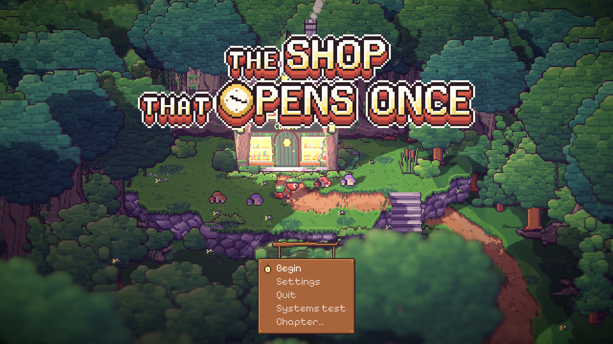
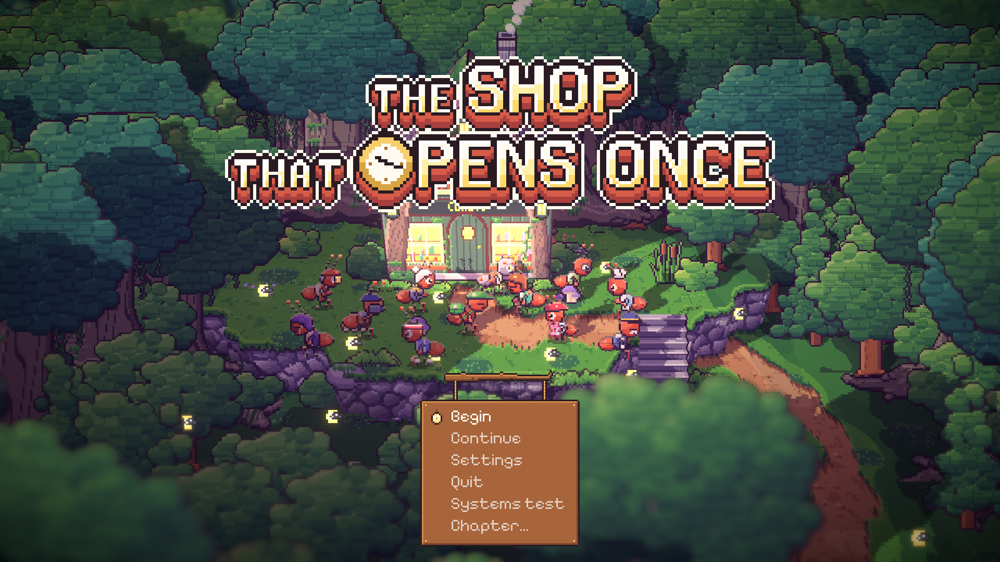

# 66. Layar Judul yang Tumbuh Bersama Simpanan

**Tanggal:** 2026-10-21

## Tujuan

Pengguna merasa layar judul kurang indah karena hanya memperlihatkan toko. Usul mereka: tampilkan Satria dan para warga
berbaris. Dari beberapa ide, pengguna memilih versi yang "didapat": warga muncul di layar judul setelah pemain menolong
mereka. Pengguna juga memilih agar menu diganti menjadi papan kayu yang digantung. Menu lama hanya kotak kertas biasa dan
terpotong di bawah layar ("Chapter..." tidak terlihat utuh).

## Yang dikerjakan

### Warga di depan pintu Marlow (`Core/Main.cs`, `Chapters/Epilogue.cs`)

- Siapa yang berdiri di depan toko ditentukan oleh bab yang tersimpan:
  - Game baru: hanya Satria di depan pintu, jadi tidak ada bagian cerita yang terbocorkan.
  - Setelah Night 1: Helen. Setelah Night 2: Mia dan Pip, yang memegang Mochi yang sudah dijahit. Lalu Theo dengan
    kameranya, Sam, dan Leo.
  - Setelah Night 6: Marlow berdiri di ambang pintunya.
  - Setelah kredit epilog selesai: warga desa ikut berdiri di lingkaran luar (Mender, Baker, Nora, Bram). Tanda tamat
    disimpan di `PlayerPrefs` dan hanya berlaku selama simpanan masih di epilog.
- Mereka dibuat sebagai `Villager` biasa, jadi tetap hidup: menoleh, bersenandung, dan mengobrol dengan yang di sebelahnya.
  Mereka dilepas lagi begitu pemain memilih menu.

### Menu papan gantung (`UI/Talk.cs`)

- `Talk.Choose` punya gaya baru, `sign`, yang dipakai layar judul.
- Menunya berupa papan kayu yang sama dengan papan nama tempat. Papan itu tergantung pada dua tali dari dahan beringin
  dan turun sedikit saat terbuka.
- Baris yang dipilih tampil dengan cat penuh dan ditandai lentera kecil Marlow yang berkedip. Baris lain tampak pudar.
- Posisinya dihitung dari jumlah pilihan, jadi seluruh papan selalu muat di layar.

Keputusannya dicatat di `GAME-CONTEXT.md`.

## Cara dicek

- Di editor: layar judul dibuka dengan tiga simpanan berbeda (game baru, bab 4, dan epilog yang sudah tamat). Ketiga
  tangkapan layar di atas berasal dari sana. Simpanan asli dikembalikan setelahnya.
- Semua 18 tes PlayMode lulus. Tes-tes itu memilih menu judul lewat papan baru ini.

## Commit

- `a2a3e72` feat(title): gather the ones Satria has helped before the shop, under a hanging sign
- `e3500c5` docs(context): record the title that grows with the save
