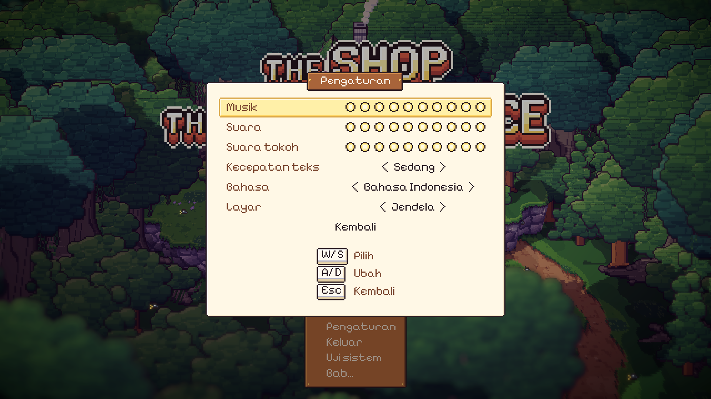
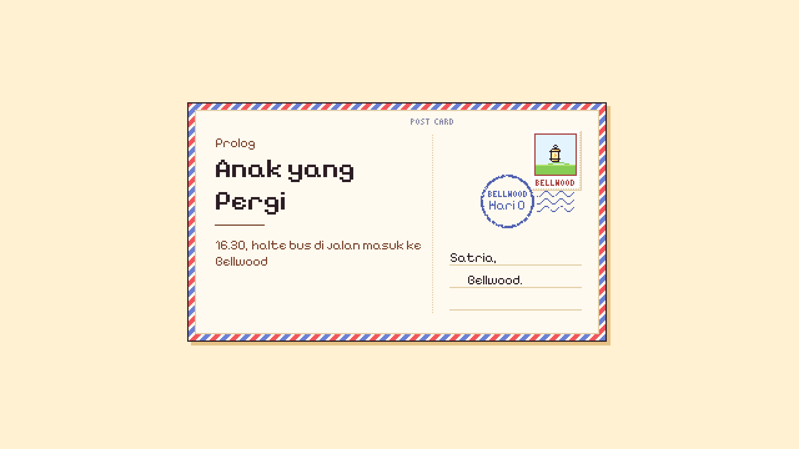
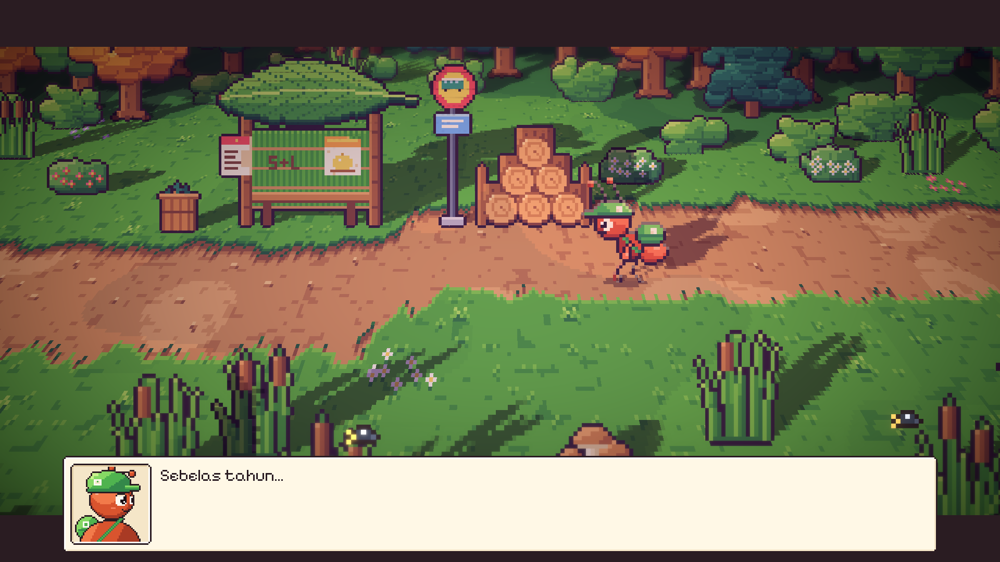
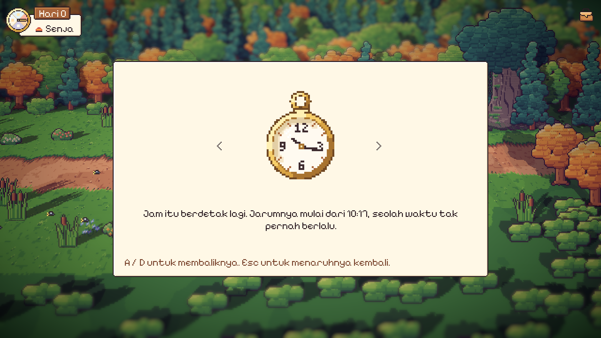
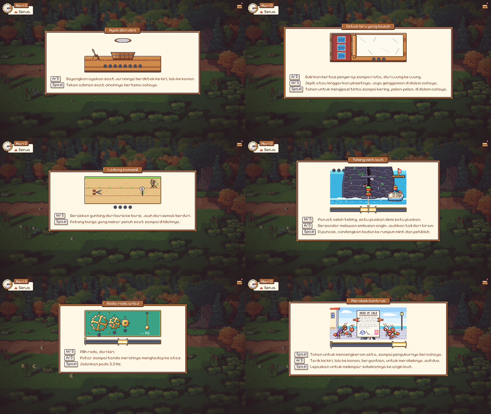
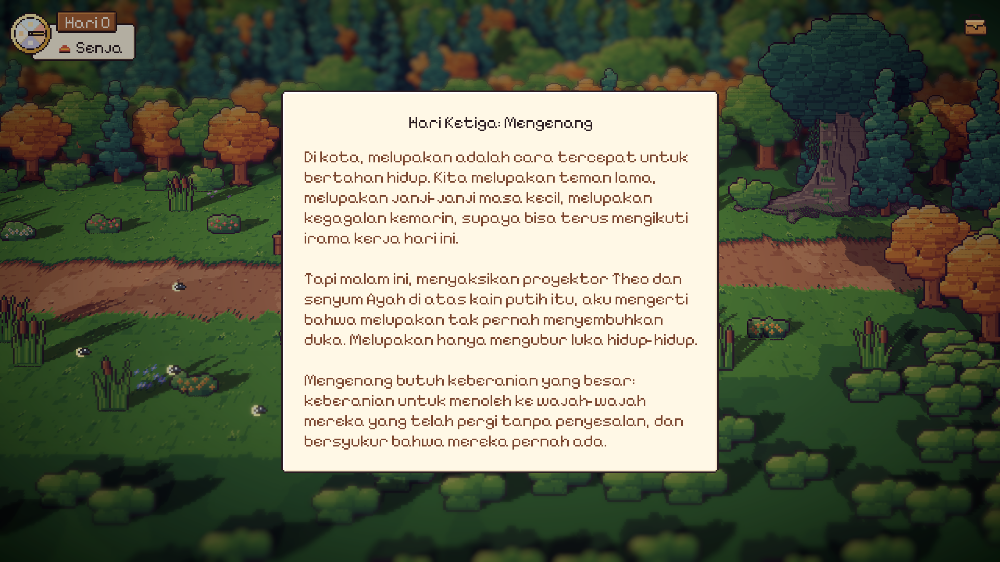

# 67. Bahasa Indonesia di Pengaturan

**Tanggal:** 2026-10-21

## Tujuan

Sebelumnya game hanya berbahasa Inggris. Pengguna ingin bisa memainkan seluruh game dalam Bahasa Indonesia. Bahasanya
dipilih langsung di halaman Pengaturan, dan hanya bisa diganti di sana. Dialog, teks cerita, menu, serta nama dan sapaan
ikut diterjemahkan. Tulisan yang menjadi bagian dari dunia game tetap berbahasa Inggris, misalnya logo, papan nama, papan
SATRIA'S POST, cap, dan ukiran. Terjemahannya ditulis sendiri, tanpa alat penerjemah otomatis.

## Yang dikerjakan

### Pilihan bahasa (`UI/Settings.cs`, `Core/Lang.cs`)

- Halaman Pengaturan punya baris baru, **Bahasa**. Isinya *English* atau *Bahasa Indonesia*, masing-masing ditulis dalam
  bahasanya sendiri.
- Begitu diganti, seluruh tulisan di layar langsung berganti bahasa, termasuk halaman Pengaturan itu sendiri. Pilihan ini
  disimpan di `PlayerPrefs`, jadi tetap berlaku saat game dibuka lagi.
- Halaman Pengaturan bisa dibuka dari layar judul maupun menu jeda. Lebar halamannya sedikit ditambah. Tombol-tombol di
  bawahnya disusun ulang setiap kali bahasa berganti, karena panjang kata dalam tiap bahasa berbeda.

### Cara kerja terjemahan

- Semua teks tetap ditulis dalam bahasa Inggris di kode. Teks bahasa Inggris itu dipakai sebagai kunci untuk mencari
  terjemahannya di `Resources/Lang/id.json` tepat saat teks ditampilkan. Pencarian ini dilakukan oleh `Lang.T`.
- Kalimat yang berisi angka, misalnya "Day {0}" (Hari 3) atau jumlah lentera yang masih menyala, memakai `Lang.F`.
- `Look.SetText` mengingat teks bahasa Inggris setiap label. Karena itu, saat bahasa berganti, semua label bisa langsung
  ditampilkan ulang dalam bahasa baru.
- Ada 1.576 baris terjemahan, mencakup:
  - dialog semua bab, dari Prolog sampai Epilog
  - kartu bab dan jurnal setiap malam
  - isi tas dan catatan
  - nama tempat, menu, dan petunjuk
  - keempat belas minigame
  - kredit
- Saat terjemahan dirakit, setiap baris dicek: penanda `{0}`, tanda `*merah*`, tag warna, dan jumlah baris baru harus sama
  dengan teks bahasa Inggrisnya.
- Kartu pos bab sekarang menerima "Malam N" dan judul bahasa Inggrisnya secara terpisah, supaya kedua bagian itu bisa
  diterjemahkan sendiri-sendiri.

### Pilihan kata

- **Sapaan:**
  - Nenek Nora, Kapten Bram, Bu Helen, Pak Valdo, Pak Baker, dan Pak Marlow.
  - Valdo yang kaku memanggil "Saudara Satria" dan memakai saya/Anda.
  - Para orang tua memanggil Satria "Nak", dan Satria menyebut dirinya "aku".
- **Nama:** Mender, Baker, dan Gardener tetap dipakai sebagai nama, sama seperti di GDD.
- **Waktu:**
  - Pagi, Siang, Senja, dan Malam.
  - Judul jurnal memakai bilangan bertingkat, misalnya "Hari Ketiga: Mengenang".
- **Tulisan di dunia game tetap berbahasa Inggris**, misalnya BELLWOOD STATION 1952, PAID IN FULL WITH FAMILY LOVE, dan FOR
  THE COURIER. Kalau ada kalimat yang membacakan tulisan semacam itu, kalimatnya menambahkan artinya, misalnya "Lunas dengan
  cinta keluarga."

Keputusannya dicatat di `GAME-CONTEXT.md`. Keputusan lama, "semua teks dalam game berbahasa Inggris", direvisi.

## Perbaikan tes `RunTest`

- `RunTest.ShiftRuns` gagal di setiap putaran kedua.
- Penyebabnya: sejak Shift dipakai untuk berganti antara jalan dan lari, tes ini mengubah pilihan langkah yang tersimpan,
  tetapi tidak mengembalikannya. Akibatnya, putaran berikutnya dimulai dalam keadaan berlari, dan ketukan Shift justru
  membuat Satria berjalan.
- Sekarang tes selalu mulai dari berjalan, lalu mengembalikan pilihan pemain setelah selesai.

## Cara dicek

- **Tes otomatis:**
  - Tes baru `ProloguePlaysInIndonesian` memainkan Prolog dalam Bahasa Indonesia. Tes ini gagal kalau ada baris yang tampil
    tanpa terjemahan.
  - Seluruh tes PlayMode juga dijalankan dengan game disetel ke Bahasa Indonesia. Semua lulus, dan tidak ada baris dari game
    yang belum diterjemahkan.
  - Setelah itu, seluruh tes dijalankan lagi dalam bahasa Inggris. Hasilnya 19 dari 19 lulus.
- **Pengecekan langsung di editor:**
  - Bahasa diganti dari halaman Pengaturan, dan seluruh layar langsung berganti bahasa.
  - Layar judul, kartu pos, dialog, jam hari, tas, jurnal, dan keempat belas papan minigame dicek satu per satu. Tidak ada
    teks yang keluar dari kotaknya.
  - Simpanan, bahasa, dan pilihan langkah pemain dikembalikan seperti semula setelah pengecekan.

## Commit

- `bd1796e` test(run): start ShiftRuns from walking and put the pace back
- `546a1b8` feat(lang): play the whole game in Bahasa Indonesia, chosen on the settings page
- `3caaf7f` docs(context): record the game in English or Bahasa Indonesia
