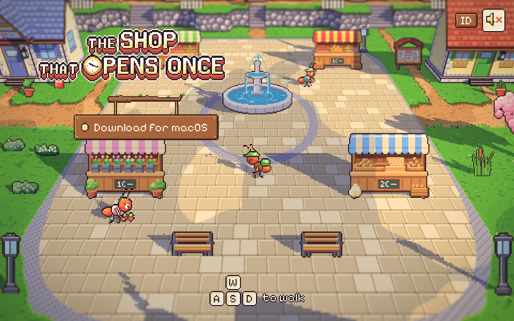
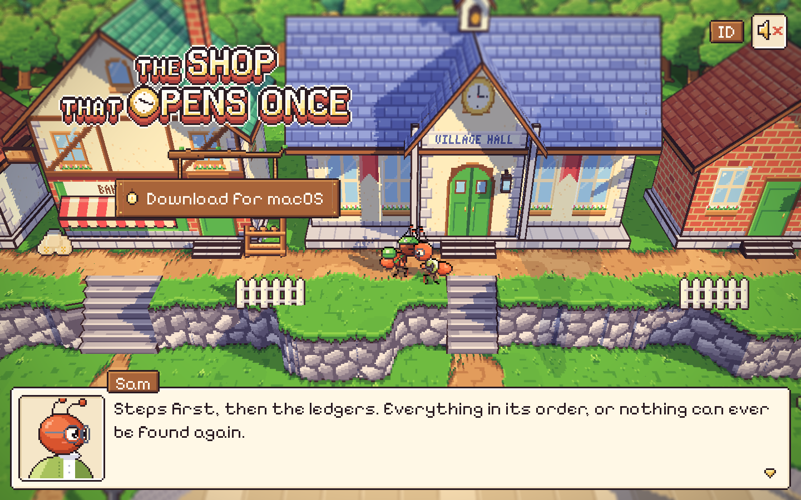
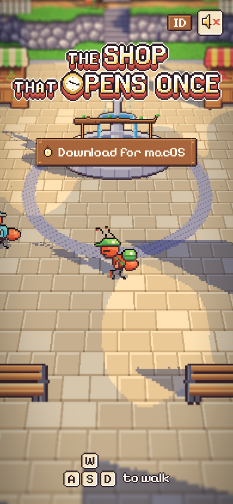

# 69. Situs pemasaran: alun-alun Bellwood yang bisa dimainkan di browser

**Tanggal:** 2026-10-24

## Tujuan

Pengguna ingin halaman web pemasaran untuk game ini, yang seinteraktif game-nya sendiri. Pengunjung pertama harus
langsung berpikir "halaman apa ini? keren sekali". Di akhir halaman, pengunjung bisa mengunduh game dan membuka repo
GitHub. Desainnya ada di `docs/superpowers/specs/2026-10-23-marketing-site-design.md`.

Langkah ini membangun layar pertama saja (hero). Sesuai aturan pengguna untuk tampilan baru, satu layar ini ditunjukkan
dulu sebelum bagian lain halaman dibangun.

## Yang dikerjakan

### Proyek `site/`

- **Alat:** Bun 1.4.4, Vite 8, TypeScript 7 (strict), three.js r186, dan `bun test`. Tanpa framework UI. Halamannya
  HTML dan CSS biasa.
- **Aset:** `tools/sync.py` menyalin aset hasil ekspor game (`game/Assets/Resources/Art`) ke `site/public/`: karakter,
  UI, ikon, alun-alun, hutan beringin, grade warna, dan terjemahan. Suara OGG diubah ke MP3 dengan ffmpeg. Jadi tidak ada
  aset baru. Semua yang tampil adalah gambar dan suara game yang dibuat lewat kode.
- **Port:** server dev memakai port 4317, karena 5173 dipakai aplikasi lain.

### Alun-alun dalam HD-2D

Dunia game di-port ke three.js dari kode Unity: relief tanah (`Relief.cs`), bangunan 3D dari model wajah di
`place.json`, kartu benda dengan animasinya, rumput dan pohon yang bergoyang, bayangan awan, bayangan matahari, lampu,
tilt-shift, bloom, dan vignette. Kamera memakai pitch 35 derajat seperti game.

### Satria dan warga

- **Berjalan:** WASD atau panah untuk berjalan, Shift untuk ganti lari dan jalan, atau ketuk tanah supaya Satria berjalan
  ke sana lewat A* di atas `walk.png` (port `WalkMap.cs`). Satria berbalik ke depan dan ke belakang memakai lembar
  gambarnya sendiri.
- **Warga:** Mia, Pip, Sam, penjual bunga, dan pembeli menjalani pagi mereka dengan putaran dan kalimat yang sama
  dengan `Core/Places.cs`.

### Bicara

- Kalau Satria cukup dekat dengan warga, gelembung muncul di atas kepala mereka. Petunjuk di bawah berubah jadi
  "Space untuk bicara".
- Kotak dialog di-port dari `UI/Talk.cs`:
  - potret dengan mulut bergerak dan kedipan;
  - papan nama;
  - kalimat yang diketik dengan kecepatan si pembicara, dengan jeda di koma dan titik;
  - bunyi suara (blip) per huruf;
  - panah "lanjut".
- Kalau kotak dialog akan menutupi Satria, kotak pindah ke atas layar.

### UI dari potongan pixel art game

- Judul `ui/title.png` diperbesar dengan skala bulat.
- Tombol Unduh adalah papan kayu (`ui/sign.png`) yang tergantung di dua tali dari dahan, seperti menu di layar judul
  game. Papan itu jatuh ke talinya saat halaman siap, dan lentera Marlow di papan sesekali berkedip.
- Tombol Unduh mengenali sistem pengunjung: zip macOS untuk Mac, zip Windows untuk Windows, dan halaman rilis untuk
  sistem lain.
- Petunjuk tombol digambar sebagai tuts W, A, S, D, dan tuts yang ditekan pengunjung ikut turun.
- Pojok kanan atas berisi:
  - tombol suara (mati sampai pengunjung menyalakannya), dengan musik pagi dan suasana alun-alun;
  - tombol EN/ID. Kalimat warga memakai terjemahan game sendiri (`Lang/id.json`).

## Gambar

## Verifikasi

- `bun test`: 4 tes `WalkMap` lulus.
- `bun run build`: `tsc --noEmit` bersih, build Vite jadi (148 kB gzip, sebagian besar three.js).
- Diuji di browser: berjalan dengan tombol, bicara dengan Sam lewat Space, gelembung dan petunjuk "Space untuk bicara",
  ganti bahasa ke Indonesia (kalimat Sam dan label Unduh ikut berganti), tampilan layar lebar 1440x900 dan ponsel
  390x844.

## Berikutnya

- Bagian halaman berikutnya, setelah pengguna melihat layar ini:
  - waktu hari yang bergerak mengikuti scroll;
  - kartu pos premis;
  - tas dan keepsake;
  - minigame jam;
  - tujuh lentera;
  - hutan beringin tengah malam dengan unduhan dan GitHub;
  - kredit.
- Gambar Open Graph untuk pratinjau tautan.
- Deploy ke Vercel, setelah bertanya ke pengguna.
