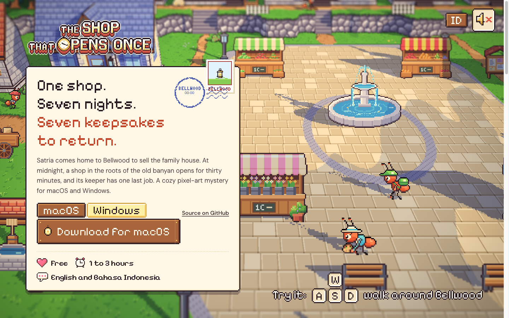
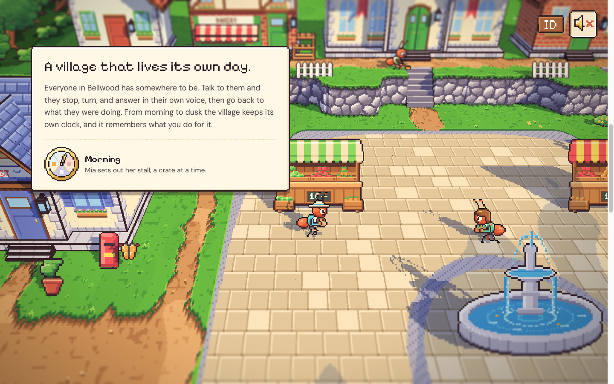
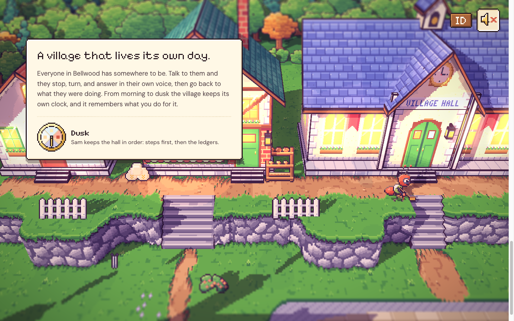

# 70. Situs pemasaran yang menjelaskan game, bukan hanya demo

**Tanggal:** 2026-10-24

## Tujuan

Pengguna melihat hero dari devlog 69 dan menilai halaman itu "lebih seperti versi demo web, bukan pemasaran". Halaman
itu tidak menjelaskan game-nya. Pengguna ingin halaman yang bekerja seperti boat.dev:

- hero menyebut dalam satu kalimat apa produknya, lalu satu kalimat kenapa, dan langsung menawarkan unduhan;
- setiap bagian sesudahnya berisi satu klaim pendek dengan bukti yang hidup di sebelahnya.

Pengguna menyetujui susunan baru: hero dan enam bagian. Bagian "cara game ini dibuat" dihapus. Spesifikasi dan
`GAME-CONTEXT.md` sudah diperbarui.

## Yang dikerjakan

### Hero: apa game ini

- **Kiri:** di atas panel kertas game ada:
  - judul `ui/title.png`;
  - headline "One shop. Seven nights. Seven keepsakes to return.";
  - satu kalimat premis;
  - tab macOS dan Windows di atas papan Unduh;
  - tautan ke kode sumber di GitHub;
  - tiga fakta dengan ikon game: gratis, 1 sampai 3 jam, Inggris dan Bahasa Indonesia.
- **Kanan:** alun-alun yang hidup sebagai bukti. Kamera membingkai Satria di tengah ruang di samping panel, dan tuts
  di bawah berbunyi "Try it: WASD walk around Bellwood".
- **Gerakan:** panel naik pelan seperti kartu pos bab di game (`Card.cs`). Setelah itu cap pos BELLWOOD "00:00" jatuh
  ke perangko berlentera Marlow, dan panelnya tersentak satu piksel.
- **Kotak dialog:** kotak dialog sekarang tetap di ruang dunia, tidak menutupi panel.

### Bagian 1: "A village that lives its own day."

- Panelnya menempel di kiri selama bagian ini di-scroll. Sementara itu hari berjalan dari pagi sampai senja.
- Kamera mengikuti Mia, lalu Pip, lalu Sam di tempat kerja mereka. Keterangan di panel menyebut siapa yang sedang
  terlihat.
- Jam hari dari HUD game (`clock_face`, `clock_hand`) ikut berputar.
- Saat senja, lampu dan jendela menyala.

### Perilaku

- Kontrol Satria hanya aktif selama hero terlihat. Setelah di-scroll, tombol panah dan Space kembali menggulir
  halaman, dan percakapan yang terbuka ditutup.
- Di ponsel, berjalan memakai klik, bukan pointerdown. Jadi geseran untuk menggulir tidak dihitung sebagai ketukan.
- Di ponsel, panel tampil di atas dunia. Tuts disembunyikan selama panel masih menutupi layar.

## Gambar

## Verifikasi

- `bun test`: 4 tes lulus.
- `bun run build`: bersih.
- Diuji di browser 1440x900 dan 390x844:
  - hero dan cap pos;
  - scroll bagian 1 di pagi, siang, dan senja, dengan keterangan dan jam yang sesuai;
  - tata letak ponsel tanpa scroll ke samping.

## Berikutnya

Setelah pengguna melihat hero dan bagian 1, bagian 2 sampai 6 dibangun dengan pola yang sama:

- toko buka tengah malam;
- tanpa penanda misi;
- perbaiki dengan tanganmu sendiri;
- tujuh malam, tujuh lentera;
- unduh di pintu toko.
