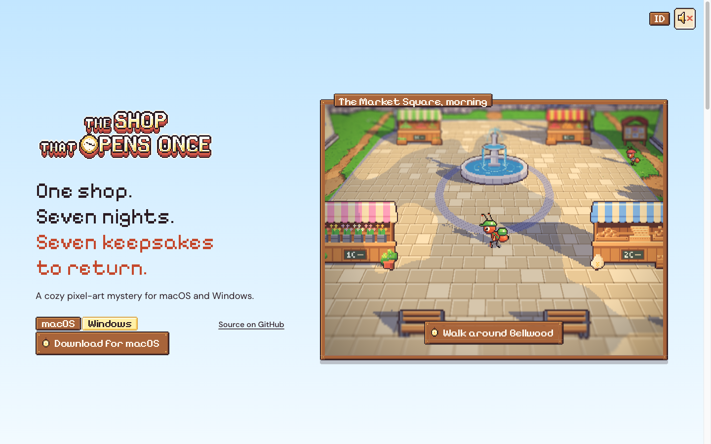
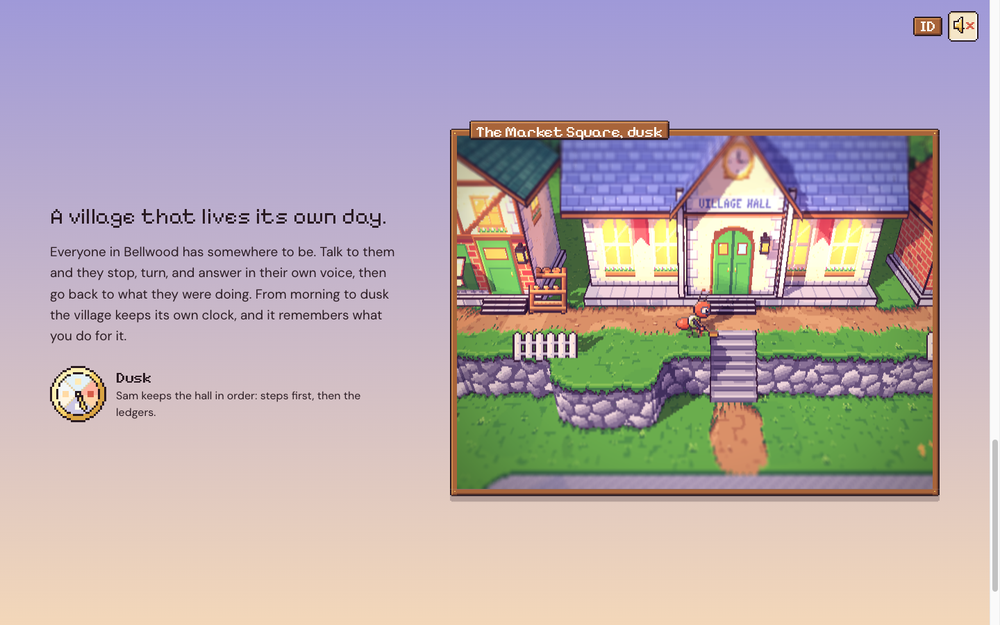
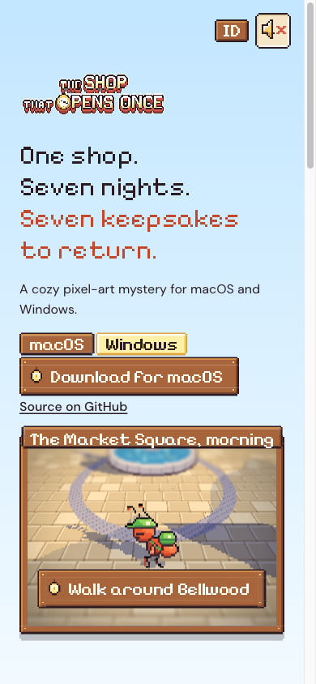
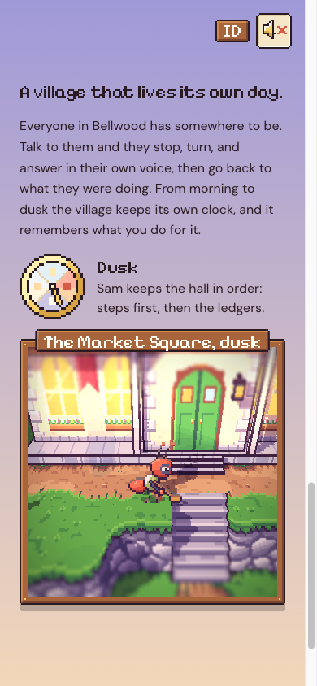

# 71. Situs pemasaran: halaman tenang dengan jendela berbingkai

**Tanggal:** 2026-10-24

## Tujuan

Pengguna menilai versi devlog 70 "berisik":

- seluruh dunia memenuhi layar dan panel teksnya "memenuhi seluruh layar";
- hero mencoba menjelaskan seluruh game;
- malamnya belum terlihat.

Pengguna ingin setiap hal dipisah, hero yang tidak menjelaskan semuanya, setiap fitur dijelaskan dengan animasinya
sendiri seperti boat.dev, dan dunia yang bisa "mengecil dan membesar". Pengguna menyetujui susunan baru, dan keputusan
itu dicatat di `GAME-CONTEXT.md`. Langkah ini membangun hero dan bagian 1 dulu untuk ditunjukkan.

## Yang dikerjakan

### Halaman yang tenang

- Latar halaman adalah langit, dan warnanya bergerak dari pagi ke senja mengikuti scroll. Warnanya diambil dari warna
  langit game sendiri. Malam datang di bagian 2.
- Setiap bagian punya teks di kiri dan jendelanya sendiri di kanan. Jendela itu berbingkai papan kayu game dan hidup.

### Hero

- Isinya hanya judul, headline "One shop. Seven nights. Seven keepsakes to return.", satu kalimat, tab macOS dan
  Windows, papan Unduh, dan tautan GitHub.
- Di kanan, alun-alun pagi tampil dalam jendela dengan plakat "The Market Square, morning".
- Papan "Walk around Bellwood" membuka jendela itu sampai memenuhi layar dengan View Transition. Di situ Satria bisa
  dimainkan: WASD, Space untuk bicara, dan ketuk tanah di ponsel.
- Esc atau tombol Close mengecilkan jendela kembali ke tempatnya.

### Bagian 1: "A village that lives its own day."

- Teksnya menempel selama bagian ini di-scroll. Jendelanya mengikuti Mia, lalu Pip, lalu Sam, dari pagi sampai senja.
- Jam hari dan plakat jendela ("The Market Square, dusk") ikut berganti.

### Satu canvas untuk semua jendela

- Hanya ada satu canvas WebGL. Canvas itu pindah ke jendela yang paling banyak terlihat.
- Jendela yang ditinggalkan menyimpan gambar diam dari frame terakhirnya, jadi tidak pernah kosong.

### Perbaikan di ponsel

- Jendela bagian 1 sempat berukuran nol di ponsel. Penyebabnya: item grid yang dipusatkan dan hanya berisi anak
  `absolute` menyusut sampai hilang. Akibatnya WebGL menggambar ke buffer kosong, muncul 191 peringatan di console, dan
  penyalinan gambar diam gagal. Sekarang lebar jendela diatur `min(100%, 48vh)`.
- Gambar diam tidak disalin lagi kalau canvas berukuran nol.
- Tautan GitHub pindah ke bawah papan Unduh, dan plakat jendela dipusatkan supaya muat. Halaman tidak bisa di-scroll ke
  samping lagi.
- Petunjuk tuts disembunyikan sejak awal di HTML, jadi tidak sempat terlihat sebelum halaman siap.

## Gambar

## Verifikasi

- `bun test`: 4 tes lulus.
- `bun run build`: bersih.
- Diuji di browser 1440x900 dan 390x844:
  - hero;
  - membuka dan menutup jendela bermain;
  - bagian 1 saat senja;
  - console tanpa peringatan;
  - halaman tanpa scroll ke samping.

## Berikutnya

Setelah pengguna melihat hero dan bagian 1, bagian berikutnya dibangun dengan pola yang sama:

- toko buka tengah malam, dan di sinilah langit menjadi malam;
- tanpa penanda misi;
- perbaiki dengan tanganmu sendiri;
- tujuh malam, tujuh lentera;
- unduh di pintu toko.
