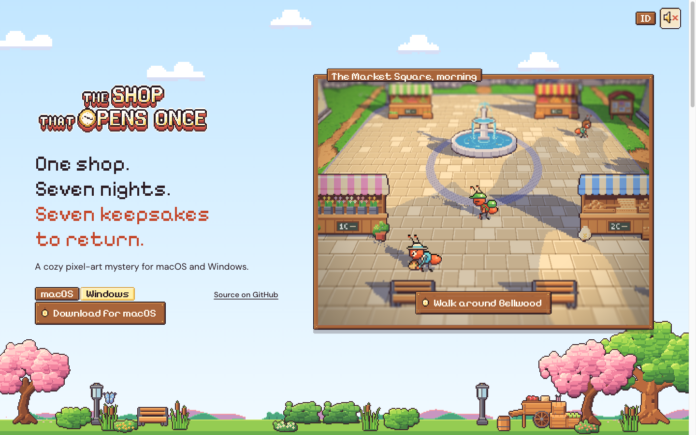
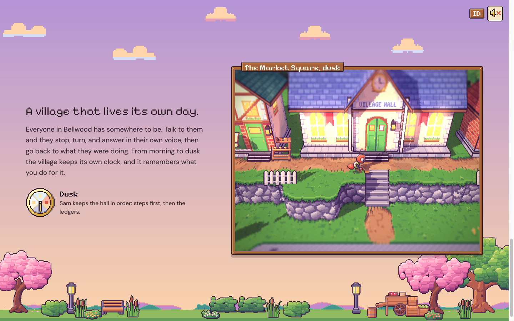
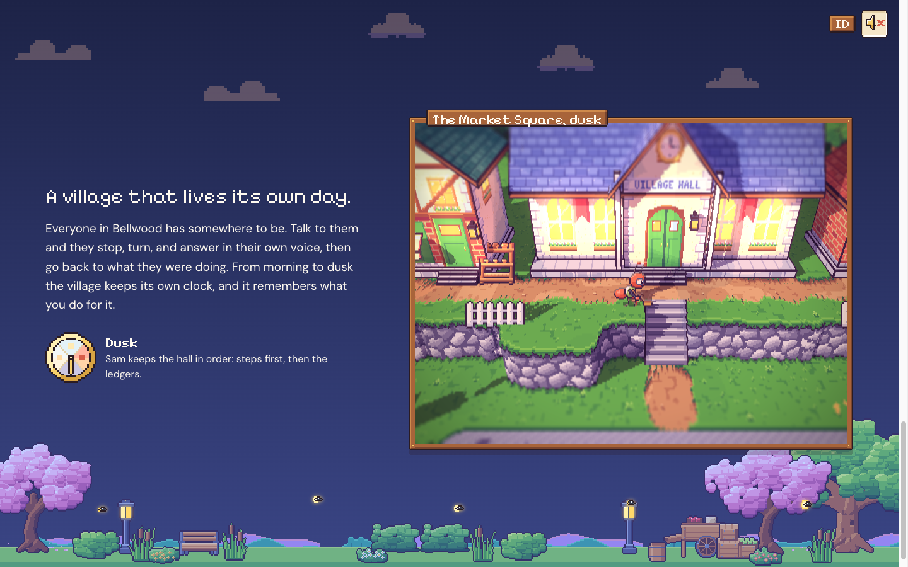
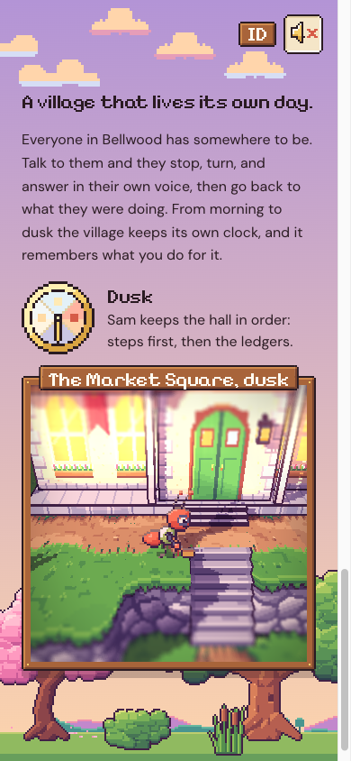

# 72. Situs pemasaran: tepi Bellwood di latar halaman

**Tanggal:** 2026-10-24

## Tujuan

Pengguna menyukai susunan dari devlog 71, tetapi latarnya "terlalu polos, hanya warna". Pengguna ingin ada awan,
pohon, rumput, dan lingkungan lain di latar. Syaratnya, semua harus dari aset game sendiri.

## Yang dikerjakan

### Tepi Bellwood (`site/src/land.ts`)

Lapisan tetap di belakang halaman. Tidak ada gambar baru, semuanya dipotong di browser dari hasil ekspor game:

- **Awan:** tiga awan diambil dari `ui/sunset_sky.png`, langit minigame lari di bukit Leo. Awan dipisahkan dari
  langitnya dengan membuang piksel yang sama dengan warna pita langit di barisnya. Langit itu punya empat frame,
  jadi awan putih di pagi dan siang, jingga saat senja, dan memudar menjelang malam.
  - Lima awan melayang pelan di bagian atas langit. Letaknya di atas teks, bukan di belakangnya.
- **Bukit jauh:** `ui/far_hills.png` diulang sepanjang cakrawala.
- **Tanah desa:** pita rumput memakai warna `grass` dari palet game. Di atasnya berdiri benda dari atlas alun-alun,
  dipotong lewat namanya di `place.json`:
  - pohon sakura dan pohon ek di tepi;
  - pagar tanaman dan semak;
  - rumput padang dan bunga;
  - dua lampu jalan, bangku, kereta dorong, peti, dan tong;
  - kupu-kupu.
  - Benda di kiri dan kanan tetap di separuh layarnya masing-masing. Benda tengah hanya muncul di layar lebar.
- **Gerak:** rumput dan semak bergoyang dengan rumus shader game (`texel()` di `pixel.ts`), satu baris piksel bergeser
  utuh. Kupu-kupu dan semua klip berjalan di loop 30 fps yang sama dengan game.
- **Waktu:** tanah diberi grade warna game untuk waktu itu. Rumusnya sama dengan shader (`v * mul + (add + shade *
  (1 - luma)) / 255`), ditulis sebagai matriks warna SVG. Jadi tanah cocok dengan jendela yang hidup.
  - Kupu-kupu pergi sebelum senja.
  - Kaca lampu menyala saat senja, dengan sedikit cahaya seperti bloom game.
  - Kunang-kunang keluar setelah senja.
- Lapisan ini disembunyikan selama alun-alun dimainkan layar penuh. Dengan `prefers-reduced-motion`, semuanya diam.

### Tata letak

- Teks dan jendela setiap bagian naik sedikit supaya tidak tertutup tanah.
- Pohon ek pindah ke kanan, di belakang sudut jendela, supaya tidak berada di belakang papan Unduh.

### Perbaikan

- Langit sempat mogok dengan galat `Cannot read properties of undefined (reading 'mul')`. Penyebabnya: stempel
  frame pertama bisa lebih awal dari waktu mulai, sehingga `dt` negatif. Waktu lalu "mundur" melewati pagi ke bawah
  nol. Sekarang `dt` tidak pernah negatif, dan `apply()` membatasi waktunya ke 0 sampai 3.

## Gambar

## Verifikasi

- `bun test`: 4 tes lulus.
- `bun run build`: bersih.
- Diuji di browser 1440x900 dan 390x844:
  - pagi, senja, dan pratinjau malam;
  - console tanpa galat atau peringatan;
  - halaman tanpa scroll ke samping.

## Berikutnya

- Bagian 2, hutan beringin saat malam. Di sana tanahnya berganti ke benda hutan: beringin tua, pakis, kayu tumbang,
  batu berlumut, dan kunang-kunang.
- Awan malam masih perlu dirapikan di bagian itu.
