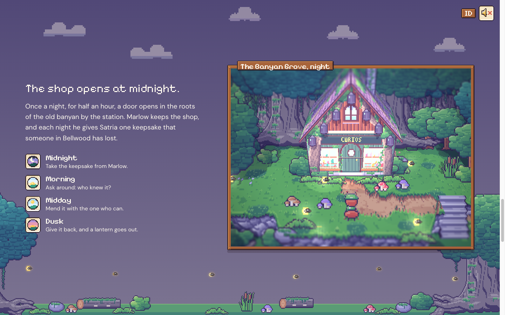
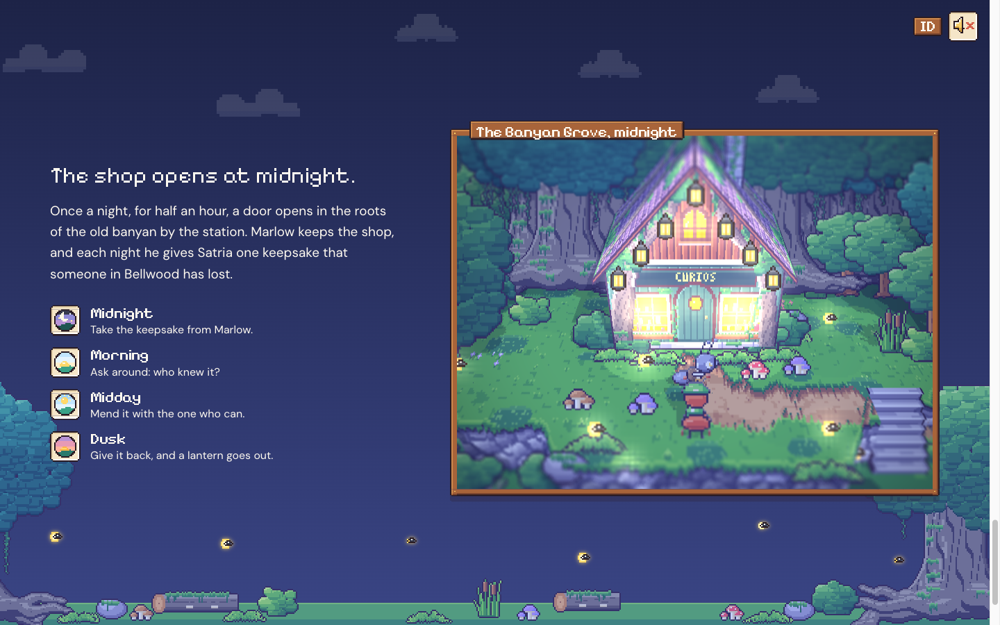
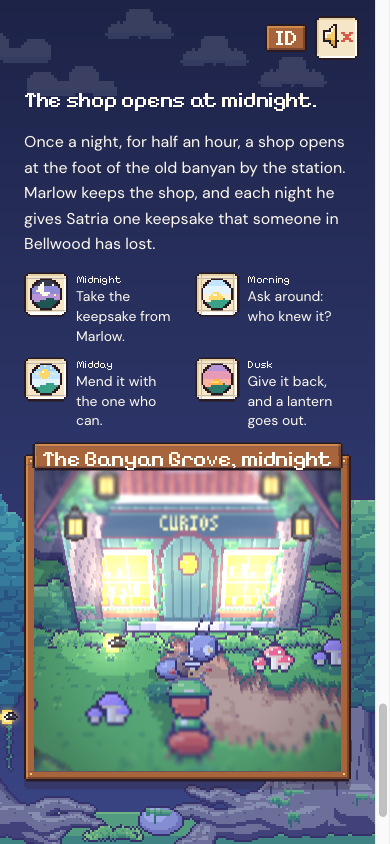

# 73. Situs pemasaran: bagian 2, toko buka tengah malam

**Tanggal:** 2026-10-24

## Tujuan

Pengguna menyetujui tepi Bellwood dari devlog 72 ("okay go"). Langkah ini membangun bagian 2 sesuai spesifikasi:
"The shop opens at midnight." Di bagian inilah langit halaman menjadi malam.

## Yang dikerjakan

### Teks

- **Judul:** "The shop opens at midnight."
- **Satu paragraf:** toko di kaki beringin tua dekat stasiun buka sekali semalam selama setengah jam. Setiap malam
  Marlow memberi Satria satu kenangan yang hilang dari seseorang di Bellwood.
- **Satu malam dalam empat langkah**, masing-masing dengan ikon fase dari HUD game (`icons/night`, `morning`,
  `midday`, `dusk`) di dalam slot:
  1. Tengah malam: terima kenangan itu dari Marlow.
  2. Pagi: tanya-tanya siapa yang mengenalnya.
  3. Siang: perbaiki bersama orang yang bisa.
  4. Senja: kembalikan, dan satu lentera padam.
- Semua teks punya versi Bahasa Indonesia.

### Jendela: Hutan Beringin

Dunia 3D sekarang memuat dua tempat, alun-alun dan hutan beringin. Kanvasnya menampilkan tempat sesuai jendela yang
sedang terlihat. Bagian ini menempel selama di-scroll, dan scroll menjalankan malamnya:

1. Senja berubah menjadi malam. Langit halaman ikut gelap, dan tulisan berganti ke warna kertas.
2. Satria menunggu di depan toko, membelakangi kamera.
3. Tengah malam:
   - lonceng berdentang (`bell_toll`);
   - papan "tutup" hilang dan jendela toko menyala (`shop_lit`);
   - Marlow muncul di pintu.
4. Tujuh lentera menyala satu per satu (`shop_lantern_*`), masing-masing dengan bunyi kecil.
5. Saat ketujuhnya menyala, Marlow melambai mengajak Satria masuk.

Detail lain:

- Scroll ke atas membalik semuanya.
- Plakat jendela berganti dari "The Banyan Grove, night" ke "The Banyan Grove, midnight".
- `shop_gone`, akar kosong dari epilog, tidak pernah tampil, supaya akhir cerita tidak bocor. Kumbang siang hutan juga
  disembunyikan.

### Tepi Bellwood di malam hari

- Saat bagian 2 masuk layar, tanah di latar memudar dan berganti ke lantai hutan dari atlas hutan:
  - beringin tua di kedua tepi;
  - pakis, batu berlumut, jamur, dan kayu tumbang;
  - kunang-kunang.
- Di malam hari awan memakai warna putihnya lagi, tetapi sangat samar, seperti diterangi bulan. Sebelumnya awan
  terlihat cokelat keruh. Pergantian warna awan sekarang tidak menumpuk dua lapis.

### Musik

Musik dan suasana mengikuti waktu, seperti di game:

- pagi: `music_dawn`;
- siang: `music_market`;
- senja: `music_dusk`;
- di hutan saat malam: `music_shop`, ditambah suara malam dan jangkrik.

Suara tetap mati sampai pengunjung menyalakannya.

### Ponsel

- Empat langkah tersusun dua kali dua, supaya teks dan jendela muat satu layar.
- Bagian yang menempel diberi jarak dari tombol pojok.
- Di jendela yang pendek, kamera hutan turun secukupnya supaya Satria tetap terlihat.

## Gambar

## Verifikasi

- `bun test`: 4 tes lulus.
- `bun run build`: bersih.
- Diuji di browser 1440x900 dan 390x844:
  - malam tiba;
  - lentera menyala satu per satu (tiga menyala di tengah jalan);
  - ketujuh lentera menyala dan Marlow melambai;
  - scroll kembali ke bagian 1, alun-alun siang bersama Pip;
  - console tanpa galat;
  - halaman tanpa scroll ke samping.

## Berikutnya

- Bagian 3: tanpa penanda misi. Tas kurir, jam saku yang bisa diputar, dan petunjuk di Notes.
- Bagian 4 sampai 6: minigame jam, tujuh lentera, dan unduh di pintu toko.
