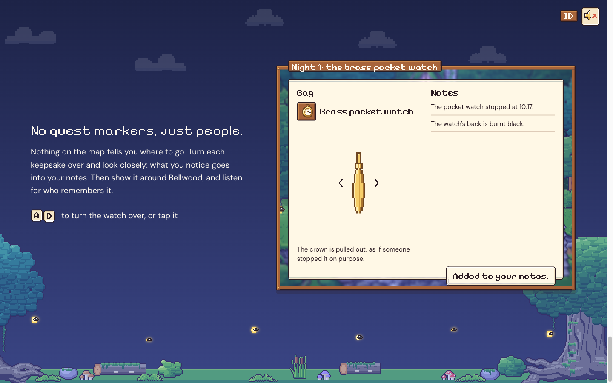
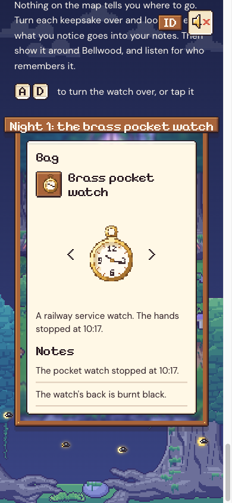

# 74. Situs pemasaran: bagian 3, tanpa penanda misi

**Tanggal:** 2026-10-24

## Tujuan

Melanjutkan "okay go" dari pengguna: bagian 3, "No quest markers, just people." Bagian ini menunjukkan inti cara
bermain: tidak ada panah atau penanda di peta. Pemain membalik kenangan, memperhatikan detailnya, lalu
menanyakannya ke orang-orang Bellwood.

## Yang dikerjakan

### Teks

- **Judul:** "No quest markers, just people."
- **Satu paragraf:** tidak ada yang menunjukkan arah di peta. Balik setiap kenangan dan lihat baik-baik. Yang kamu
  perhatikan masuk ke catatan. Lalu tunjukkan ke orang-orang dan dengarkan siapa yang mengingatnya.
- **Petunjuk:** tombol A dan D (gaya tombol HUD game) untuk membalik jam, atau ketuk jamnya.
- Semua teks punya versi Bahasa Indonesia.

### Jendela: tas kurir (`site/src/ui/bag.ts`)

Port dari `UI/Bag.cs` di game, ditaruh di atas hutan beringin pada tengah malam (toko terbuka, tujuh lentera menyala):

- **Kiri, "Bag":** slot jam saku kecil, nama "Brass pocket watch", jam besar dengan tombol `<` dan `>`, dan kalimat
  untuk sisi yang sedang terlihat. Ada tiga sisi, sesuai `Core/Keepsakes.cs`:
  - depan: jarum berhenti di 10:17;
  - belakang: hangus hitam, berbau belerang;
  - samping: kenop tertarik keluar, seperti dihentikan dengan sengaja.
- **Kanan, "Notes":** setiap sisi yang punya catatan menambahkannya ke daftar satu kali. Seperti di game, toast "Added
  to your notes." muncul selama 4 detik dengan bunyi `page`. Catatan baru muncul dengan sedikit gerak.
- **Main sendiri:** saat jendela masuk layar, tas membalik jam sendiri tiap 2,6 detik, satu putaran, lalu berhenti di
  sisi depan. Begitu pengunjung membaliknya (A/D, panah kiri/kanan, tombol `<` `>`, atau ketuk), tas tidak membalik
  sendiri lagi.
- Semua kalimat game diambil dari terjemahannya sendiri (`id.json`) lewat `lang.t()`.
- Plakat jendela: "Night 1: the brass pocket watch". Hanya Malam 1, jadi tidak ada yang bocor.

### Ponsel

- Bagian 3 sekarang ikut disusun satu kolom seperti hero dan bagian 2. Sebelumnya teksnya terjepit di kolom sempit
  dan halaman bisa di-scroll ke samping (lebar 446 px di layar 390 px).
- Jendela tas lebih tinggi (9:14). Isi tas tersusun ke bawah: jam di atas, Notes di bawahnya. Jamnya sedikit lebih
  kecil.
- Toast pindah ke tengah bawah supaya tidak menutupi catatan.

## Gambar

## Verifikasi

- `bun test`: 4 tes lulus.
- `bun run build`: bersih.
- Diuji di browser 1440x900 dan 390x844:
  - tas membalik jam sendiri satu putaran, dan kedua catatan masuk;
  - toast muncul lalu hilang;
  - tombol D membalik jam;
  - isi tas tidak terpotong;
  - console tanpa galat atau peringatan;
  - halaman tanpa scroll ke samping.

## Berikutnya

- Bagian 4: "Mend it with your own hands", minigame menyetel jam (ClockworkAlign) yang bisa dimainkan.
- Bagian 5 dan 6: tujuh lentera dan kartu pos, lalu unduh di pintu toko.
