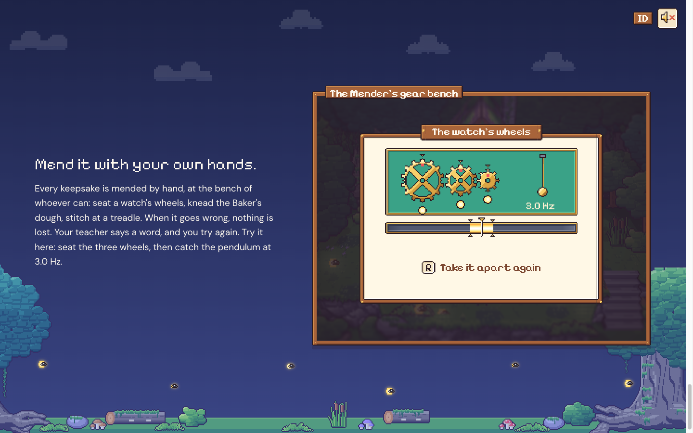
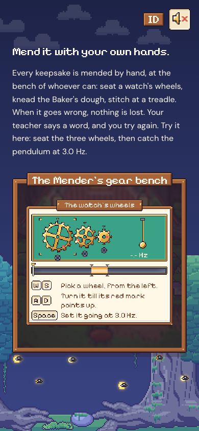

# 75. Situs pemasaran: bagian 4, perbaiki dengan tanganmu sendiri

**Tanggal:** 2026-10-24

## Tujuan

Bagian 4 dari spesifikasi: "Mend it with your own hands." Pengunjung bisa langsung memainkan minigame jam dari
Malam 1 (`ClockworkAlign`) di halaman, persis seperti di game.

## Yang dikerjakan

### Teks

- **Judul:** "Mend it with your own hands."
- **Satu paragraf:**
  - setiap kenangan diperbaiki dengan tangan, di meja kerja orang yang bisa;
  - contohnya memasang roda arloji, menguleni adonan Baker, dan menjahit di mesin injak (semuanya dari Malam 1 sampai
    3, supaya tidak ada yang bocor);
  - kalau gagal, tidak ada yang hilang;
  - ajakan mencoba di jendela sebelahnya.
- Semua teks punya versi Bahasa Indonesia.

### Jendela: meja roda gigi Mender (`site/src/ui/mend.ts`)

Port dari `Minigames/ClockworkAlign.cs` di atas papan permainannya (`UI/Board.cs`):

- **Papan:** bingkai `bench` di atas dunia yang digelapkan (tinta 82%). Di tepi atasnya ada papan judul `plate`
  bertuliskan "The watch's wheels". Di bawahnya ada baris petunjuk dengan tombol tombol keyboard.
- **Area main (200x92 px seni):** digambar di kanvas dengan potongan asli game. Isinya:
  - kain `baize`;
  - tiga roda (`gear_great`, `gear_third`, `gear_escape`), masing-masing 12 frame putaran;
  - panah `notch` di atas setiap roda dan soket `pip` di bawahnya;
  - kurung `bracket` di roda yang sedang dipegang;
  - bandul `pendulum`, 7 frame;
  - meter: `gauge` dengan pita `glow` yang berdenyut seperti besi panas, takik kuningan, `needle`, dan percikan saat
    berhasil.
- **Aturan, sama dengan game:**
  - roda mulai di 5, 8, dan 3 langkah;
  - W/S memilih roda, A/D memutar satu langkah;
  - roda terpasang saat tanda merahnya menghadap ke atas, lalu pilihan pindah ke roda berikutnya;
  - memutar roda sebelum roda di kirinya terpasang membuatnya selip (gagal A);
  - setelah ketiganya terpasang, laju bandul berkelana antara 2 dan 4 Hz. Spasi menjalankan jam hanya kalau jarumnya
    di pita 3,0 Hz (gagal B).
- **Gagal:** papan bergoyang, lalu kotak bicara muncul di dalam jendela:
  - gagal A: Mender, dengan potretnya;
  - gagal B: Satria, bicara sendiri.

  Kalimatnya diketik dengan suara masing-masing. R (Coba lagi) mengulang tanpa kehilangan apa pun.
- **Berhasil:** bunyi `ticktock` dan `chime`, percikan, dan bandul berayun tetap di 3,0 Hz. Baris petunjuk berganti
  menjadi "R: Bongkar lagi".
- Semua bunyi dari game: `pop`, `click`, `latch`, `ting`, `wrong`, `chime`, `ticktock`.

### Kendali

- **Keyboard:** papan menerima tombolnya selama jendelanya yang paling terlihat. Spasi hanya diambil saat jam
  menunggunya, jadi di saat lain spasi tetap menggulir halaman.
- **Sentuh:** setiap tombol di baris petunjuk juga bisa diketuk. Tombol itu turun saat ditekan, dari keyboard maupun
  ketukan.

### Skala piksel

- Papan memakai skalanya sendiri (`--k`): skala terbesar yang muat di jendela, dalam kelipatan utuh piksel layar,
  dan tidak pernah melebihi skala halaman. Piksel seni tetap tajam di layar 1x, 2x, maupun 3x.
  - Di desktop: 2x.
  - Di iPhone (3x): 4 piksel layar per piksel seni.
- Ukuran papan tetap ketika baris petunjuk berganti ke "Coba lagi": semua baris tersusun di tempat yang sama dan
  hanya yang aktif yang terlihat, seperti di Board.
- Di ponsel, papan dibuat lebih ramping dan teks petunjuknya boleh turun baris. Dengan begitu skalanya bisa naik dari
  1x.

### Perbaikan

Kotak bicara mewarisi ukuran huruf halaman (22 px), bukan skalanya sendiri. Akibatnya:

- di jendela kecil, teksnya meluap;
- di mode main layar penuh 3x, teksnya terlalu kecil.

Sekarang `.talk` punya ukuran hurufnya sendiri.

## Gambar

## Verifikasi

- `bun test`: 4 tes lulus.
- `bun run build`: bersih.
- Diuji di browser:
  - 1440x900:
    - gagal A dengan kalimat Mender;
    - memasang ketiga roda, lalu menangkap 3,0 Hz sampai berhasil;
    - lebar papan tetap.
  - 390x844 (1x dan 3x): gagal lewat ketukan tombol, dan kotak bicara muat di jendela.
  - Bahasa Indonesia: judul dan petunjuk berganti.
  - Console tanpa galat atau peringatan.
  - Halaman tanpa scroll ke samping.

## Berikutnya

- Bagian 5: "Seven nights, seven lanterns". Kartu pos tiap malam, dengan Malam 6 dan 7 tersegel.
- Bagian 6: unduh di pintu toko, fakta game, dan footer.
