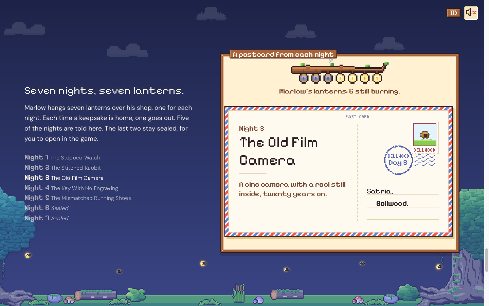
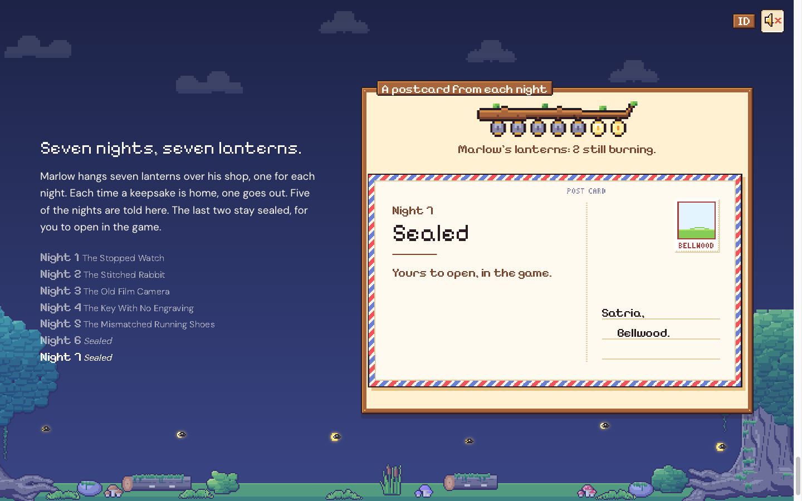
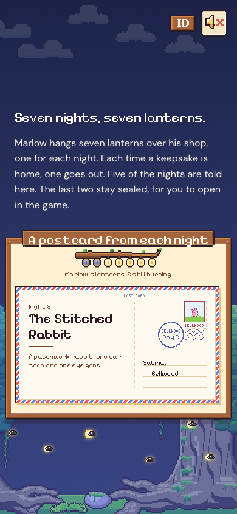

# 76. Situs pemasaran: bagian 5, tujuh malam, tujuh lentera

**Tanggal:** 2026-10-24

## Tujuan

Bagian 5 dari spesifikasi: "Seven nights, seven lanterns."

- Lentera Marlow tergantung di dahan beringin, seperti di HUD game.
- Malam 1 sampai 5 masing-masing tampil sebagai kartu pos, dengan kenangannya dan satu kalimat pembuka.
- Malam 6 dan 7 tersegel: tanpa kenangan dan tanpa petunjuk, dan lenteranya tetap menyala.

## Yang dikerjakan

### Teks

- **Judul:** "Seven nights, seven lanterns."
- **Paragraf:** Marlow menggantung tujuh lentera, satu untuk setiap malam, dan satu padam setiap kali sebuah kenangan
  pulang. Lima malam diceritakan, dua tetap tersegel.
- **Daftar tujuh malam** dengan judul dari game (Malam 6 dan 7: "Tersegel"). Malam yang sedang tampil di jendela
  ditandai terang (`aria-current`). Di ponsel daftar ini disembunyikan karena kartunya sudah memuat isinya.
- Semua teks punya versi Bahasa Indonesia. Judul malam memakai terjemahan game sendiri.

### Jendela: kartu pos (`site/src/ui/post.ts`)

Port dari `UI/Card.cs` (kartu judul setiap bab) dan lentera dari `UI/Dial.cs`, di atas warna krem game (`#fff1d2`).

- **Kartu pos** (`postcard.png`, 339x195 px seni):
  - di sisi pesan: "Night N", judul malam dua kali ukuran huruf, garis, dan satu kalimat pembuka (tulisan halaman
    sendiri, tanpa bocoran);
  - di sisi alamat: "Satria," dan "Bellwood.";
  - perangko (`stamp.png`) berisi gambar kecil kenangan malam itu: jam, kelinci, kamera, kunci, dan sepatu.
- **Gerak, sama dengan game:**
  1. kartu naik dari bawah selama 0,45 detik dengan perlambatan;
  2. 0,2 detik kemudian cap pos (`postmark.png`, "Day N") jatuh dengan bunyi `stamp`;
  3. kartu tersentak 2 px.
- **Lentera:** tujuh `hud_lantern` tergantung di `branch`, berkedip seperti di HUD.
  - Setiap kartu Malam 1 sampai 5 selesai dicap, lentera malam itu padam dengan asap (`hud_smoke`, 1,6 detik) dan
    bunyi `lantern_out`.
  - Di bawahnya tertulis kalimat HUD: "Marlow's lanterns: N still burning."
  - Lentera berkedip saat disentuh tetikus atau diketuk.
- **Malam 6 dan 7:** kartu bertuliskan "Sealed" dan "Yours to open, in the game." Perangkonya kosong, tanpa cap pos,
  dan lenteranya tetap menyala.
- **Scroll:**
  - Bagian ini menempel selama 300vh dan setiap malam mendapat sepertujuh jalannya.
  - Scroll ke bawah memainkan kedatangan kartu.
  - Scroll ke atas langsung menampilkan kartunya dan menyalakan lagi lentera yang belum waktunya padam.
  - Malam yang terlewati karena scroll cepat dihitung sudah pulang, jadi lenteranya padam.
- Dengan `prefers-reduced-motion`, kartu muncul langsung tanpa naik. Cap posnya tetap jatuh.
- Jendela ini tidak memakai kanvas 3D, karena isinya krem kartu pos. Kanvas hanya berpindah ke jendela yang punya
  layar dunia.

### Skala piksel

Seperti meja roda gigi, kartu dan dahannya memakai skala sendiri: kelipatan utuh piksel layar, tidak melebihi skala
halaman.

- Di desktop 2x, dengan dahan dan lentera 4x. Jendelanya sedikit lebih tinggi (6:5) supaya muat.
- Di ponsel jendelanya selebar layar (5:4), sehingga kartunya bisa 1x.

## Gambar

## Verifikasi

- `bun test`: 4 tes lulus.
- `bun run build`: bersih.
- Diuji di browser:
  - 1440x900:
    - kartu Malam 1 naik dan dicap;
    - Malam 3 menyisakan 4 lentera;
    - lompat ke Malam 7 menyisakan 2 lentera;
    - kembali ke Malam 1 menyisakan 6;
    - maju lagi ke Malam 5 menyisakan 2.
  - 390x844 (3x): kartu muat pada 1x, halaman tanpa scroll ke samping, console tanpa galat atau peringatan.

## Berikutnya

- Bagian 6: pintu toko di tengah malam, unduhan di cahayanya, fakta game, dan footer.
