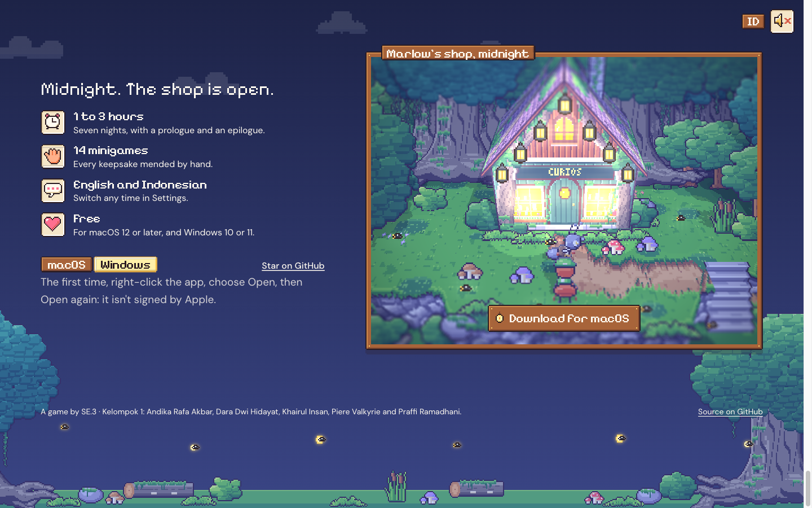
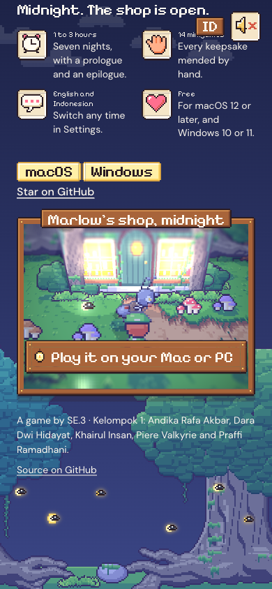

# 77. Situs pemasaran: bagian 6, unduh di pintu toko

**Tanggal:** 2026-10-24

## Tujuan

Bagian terakhir dari spesifikasi:

- pintu toko Marlow terbuka di tengah malam, dan tombol Unduh berdiri di cahayanya;
- fakta game di sampingnya;
- catatan "pertama kali dibuka" dari README;
- tautan GitHub;
- footer yang tenang.

Dengan ini keenam bagian halaman selesai.

## Yang dikerjakan

### Teks

- **Judul:** "Midnight. The shop is open."
- **Empat fakta**, dengan ikon HUD game di dalam slot, seperti langkah-langkah di bagian 2:
  - **1 to 3 hours:** tujuh malam, dengan prolog dan epilog (`icons/clock`);
  - **14 minigames:** setiap kenangan diperbaiki dengan tangan (`icons/hand`);
  - **English and Indonesian:** bisa diganti kapan saja di Pengaturan (`icons/talk`);
  - **Free:** untuk macOS 12 ke atas, dan Windows 10 atau 11 (`icons/heart`).

  Semuanya diambil dari README.
- **Tab macOS dan Windows,** dengan catatan pertama kali membuka untuk sistem yang dipilih (dari README, karena
  kedua build belum ditandatangani):
  - macOS: klik kanan, pilih Open, lalu Open lagi;
  - Windows: SmartScreen, pilih More info, lalu Run anyway.
- **"Star on GitHub"** ke repositori.
- **Footer:** nama tim (SE.3 · Kelompok 1 dan kelima anggotanya) dan "Source on GitHub". Footer berada di layar
  terakhir bersama pintu toko, di atas tanah latar.
- Repositori belum punya berkas lisensi, jadi footer tidak menyebut lisensi.
- Semua teks punya versi Bahasa Indonesia.

### Jendela: toko Marlow, tengah malam

- Hutan beringin, toko terbuka dengan ketujuh lenteranya menyala, Marlow di pintu, dan Satria di depannya.
- Tombol Unduh (papan kayu dengan lentera Marlow yang berkedip) berdiri di bawah pintu, seperti tombol Play di hero.

### Unduh di seluruh halaman (`site/src/ui/hud.ts`)

- HUD sekarang mengurus setiap tombol Unduh di halaman, bukan hanya yang di hero. Tab di hero dan di pintu toko
  saling mengikuti, dan tautannya mengarah ke zip yang sama dari rilis terbaru di GitHub.
- Lentera di setiap papan berkedip dengan iramanya masing-masing.
- **Di ponsel**, tombolnya bertuliskan "Play it on your Mac or PC" dan membuka halaman rilis. Ponsel tidak bisa
  menjalankan zip-nya. Catatan pertama kali disembunyikan.

## Gambar

## Verifikasi

- `bun test`: 4 tes lulus.
- `bun run build`: bersih.
- Diuji di browser:
  - 1440x900:
    - layar terakhir memuat jendela pintu dan footer;
    - tab Windows di pintu mengganti tautan ke zip Windows, catatannya, dan tab di hero;
    - hero masih bisa dibuka layar penuh dan ditutup dengan Esc;
    - console tanpa galat atau peringatan.
  - 390x844 (3x, iPhone): tombolnya "Play it on your Mac or PC" ke halaman rilis, dan halaman tanpa scroll ke
    samping.

## Berikutnya

- Gambar Open Graph untuk pratinjau tautan.
- Satu putaran `prefers-reduced-motion` untuk seluruh halaman.
- Deploy ke Vercel, setelah ditanyakan ke pengguna.
