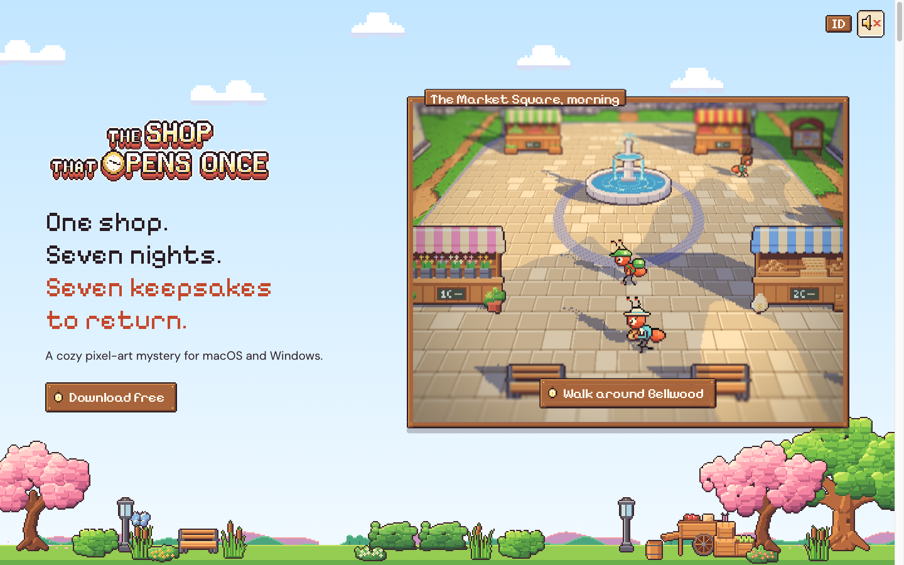
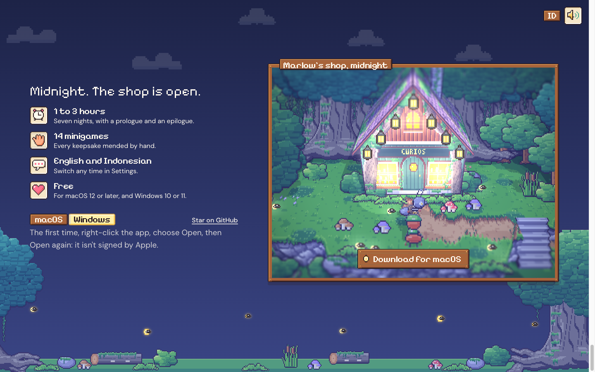
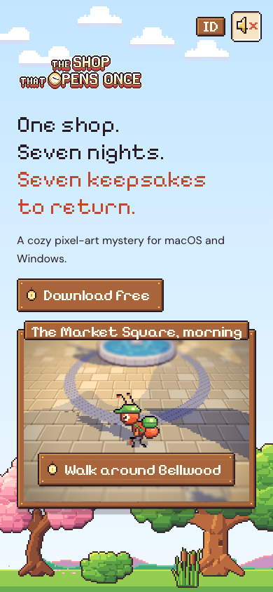

# 78. Situs pemasaran: unduh lengkap cukup sekali, di pintu toko

**Tanggal:** 2026-10-24

## Tujuan

Masukan pengguna setelah keenam bagian selesai:

- **Redundan:** hero dan bagian terakhir sama-sama punya tombol Unduh dan tautan GitHub.
- **Terkesan hanya untuk Mac:** saat hero hanya bertuliskan "Download for macOS", pengunjung bisa mengira game ini
  hanya untuk Mac.
- **Lompatan:** tombol yang menuju bagian unduh jangan melompat seketika. Halaman harus bergerak ke sana.
- **Footer:** baris nama tim dihapus.
- **Lisensi:** pengguna ikut rekomendasi agen.

## Yang dikerjakan

### Hero: "Download free"

- Tab macOS/Windows dan tautan GitHub di hero dihapus.
- Hero sekarang punya satu papan "Download free" (Bahasa Indonesia: "Unduh gratis"). Papan ini membawa pengunjung ke
  pintu toko (bagian 6), tempat ia memilih macOS atau Windows.
- Baris di atasnya tetap menyebut "for macOS and Windows". Dengan begitu kedua sistem terbaca sejak layar pertama.

### Meluncur ke pintu toko

- Klik "Download free" tidak melompat. Halaman meluncur ke pintu toko selama 1,8 detik dengan perlambatan di awal
  dan akhir. Sepanjang jalan langit bergerak dari pagi ke tengah malam, jadi pengunjung melihat sehari di Bellwood
  berlalu.
- Selama meluncur, lonceng tengah malam dan bunyi lentera tidak dibunyikan, supaya tidak berbunyi bersamaan.
- Roda tetikus, sentuhan, atau tombol keyboard menghentikan luncuran, dan kendali scroll kembali ke pengunjung.
- Setelah sampai, fokus pindah ke tombol Unduh di pintu, supaya pengguna keyboard langsung berada di sana.
- Dengan `prefers-reduced-motion`, tautan melompat langsung ke `#download`.
- Tanpa JavaScript, tautan tetap berfungsi sebagai lompatan biasa.

### Pintu toko tetap lengkap

Tab macOS/Windows, catatan pertama kali membuka, tombol Unduh di cahaya pintu, dan "Star on GitHub". Sekarang
GitHub hanya muncul sekali di halaman.

### Footer dan lisensi

- Footer dihapus seluruhnya, karena isinya hanya baris nama tim.
- Repositori tidak diberi lisensi. Tanpa berkas lisensi, karya ini otomatis "semua hak dilindungi": orang lain
  boleh melihat dan mengunduh game-nya, tetapi tidak boleh memakai ulang kode atau gambarnya.
  - Ini cocok untuk game tugas kuliah milik lima orang.
  - Memilih lisensi terbuka sebaiknya keputusan seluruh tim, dan bisa ditambahkan kapan saja.
  - Spesifikasi dan `GAME-CONTEXT.md` mencatat keputusan ini.

### Lain-lain

Tab browser sekarang punya ikon lentera Marlow (`icons/lantern.png`). Sebelumnya `favicon.ico` 404 di console.

## Gambar

## Verifikasi

- `bun test`: 4 tes lulus.
- `bun run build`: bersih.
- Diuji di browser:
  - 1440x900:
    - posisi scroll saat meluncur: 361, 6438, 10608, lalu 10800 (berhenti tepat di `#download`);
    - fokus berpindah ke tombol Unduh di pintu;
    - layar terakhir tanpa footer;
    - console tanpa galat (favicon sudah ada).
  - 390x844 (3x, iPhone): hero dengan "Download free", dan halaman tanpa scroll ke samping.

## Berikutnya

- Gambar Open Graph untuk pratinjau tautan.
- Satu putaran `prefers-reduced-motion` untuk seluruh halaman.
- Deploy ke Vercel, setelah ditanyakan ke pengguna.
