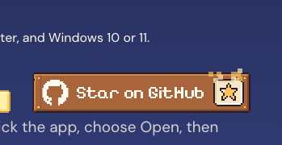
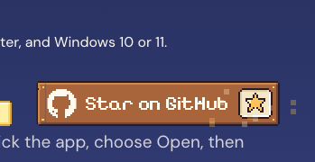
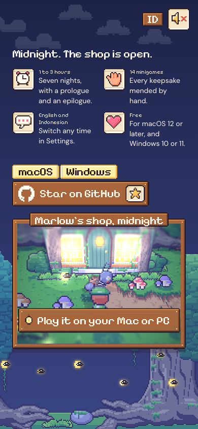

# 79. Situs pemasaran: "Star on GitHub" bergaya game

**Tanggal:** 2026-10-24

## Tujuan

Pengguna menilai tautan "Star on GitHub" terlalu polos. Rujukannya komponen GitHub Stars dari Animate UI: bintang
yang terisi, angka yang naik, dan ledakan partikel. Pengguna juga membuka pilihan untuk membuat komponen sendiri yang
cocok dengan gaya game.

## Keputusan

Komponen dibuat sendiri, tidak memakai Animate UI:

- komponen itu React dan shadcn, sementara halaman ini HTML dan TypeScript biasa tanpa framework;
- gayanya rapi dan gelap, tidak cocok dengan potongan pixel art game.

Yang diambil dari rujukannya hanya idenya: bintang terisi, hitungan naik, dan percikan.

## Yang dikerjakan (`site/src/ui/stars.ts`)

- **Papan kayu kecil** (`sign.png`), seperti papan Unduh, berisi:
  - tanda GitHub sebesar 16 px warna kertas, dibuat dari jalur resmi Octicons lalu dibulatkan ke piksel utuh supaya
    tajam seperti seni game;
  - tulisan "Star on GitHub";
  - slot krem (`slot.png`) berisi bintang piksel 11x11 dan jumlah bintang repositori.
- **Bintang piksel** digambar di kode, sepiksel demi sepiksel, seperti aturan seni game. Ada dua keadaan, kosong dan
  terisi emas. Warna emas dan kilaunya sama dengan percikan di game.
- **Animasi:**
  - saat papan pertama kali terlihat penuh, bintang terisi emas dengan "pop" bertahap dan bunyi `ting` (kalau suara
    menyala);
  - sepuluh percikan terlempar ke atas lalu jatuh, seperti percikan pukulan di `Meter` game;
  - jumlah bintang naik dari 0 dengan perlambatan.
- **Hover atau fokus** melempar percikan lagi, paling cepat sekali tiap 0,6 detik.
- **Jumlah bintang** diambil dari API GitHub (`stargazers_count`). Angkanya hanya tampil kalau minimal 1. Saat ini
  repositori belum punya bintang, dan "0" tidak dipamerkan. Kalau GitHub tidak menjawab (offline atau batas
  permintaan), papan tetap menjadi tautan biasa.
- Dengan `prefers-reduced-motion`, tidak ada percikan.
- Di ponsel papan berada di bawah tab macOS/Windows.

## Gambar

## Verifikasi

- `bun test`: 4 tes lulus.
- `bun run build`: bersih.
- Diuji di browser:
  - 1440x900:
    - bintang terisi saat papan terlihat;
    - hover memunculkan 10 percikan yang terbang keluar dari slot;
    - console tanpa galat.
  - 390x844 (3x): halaman tanpa scroll ke samping.
