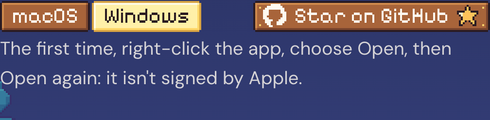
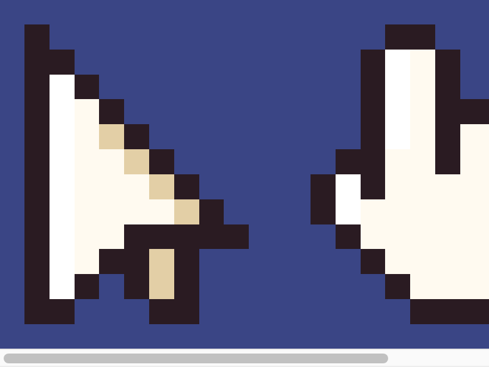
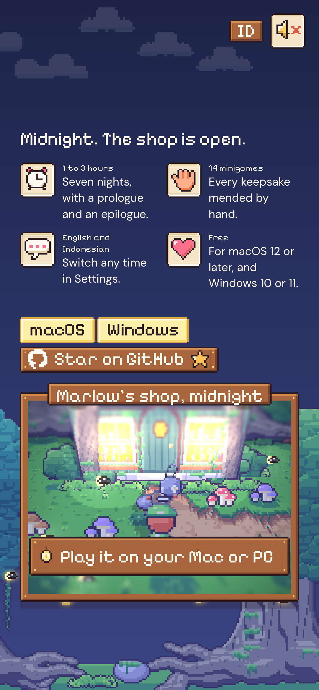

# 80. Situs pemasaran: kursor game, papan GitHub sejajar tab, dan halaman yang lebih ringan

**Tanggal:** 2026-10-24

## Tujuan

Masukan pengguna:

- **Kursor:** halaman masih memakai kursor sistem, padahal game punya kursor sendiri.
- **Ukuran:** papan "Star on GitHub" terlihat jauh lebih besar daripada tab macOS dan Windows di sebelahnya.
- **Kinerja:** halaman terasa berat di browser Helium. Apakah karena banyak aplikasi sedang terbuka?

## Yang dikerjakan

### Kursor game (`site/src/ui/cursor.ts`)

- Memakai kursor dari HUD game (`Hud.cs`): panah `cursor.png` (10x12), dan tangan `cursor_hand.png` (12x12) di atas
  apa pun yang bisa dipakai (tautan, tombol, tab, lentera, meja roda gigi).
- Titik tekannya dibaca dari `ui.json`, sama dengan game: panah di pucuknya, tangan di ujung jari.
- **Ukuran:** 2x seni (20x24 px), seukuran kursor sistem dan di bawah batas aman 32 px.
- **Ketajaman:** gambar diperbesar per piksel untuk layar itu (4x seni di layar 2x) lewat `image-set`, jadi tetap
  tajam. Browser yang tidak mengenal `image-set` untuk kursor mendapat gambar 2x biasa.
- Sebelum gambarnya siap, atau kalau gagal dimuat, kursor sistem tetap dipakai.

### Papan GitHub setinggi tab

- Tab macOS/Windows dan papan GitHub sekarang sama tinggi (16 px seni) dan berdiri di garis yang sama.
- Isi papan:
  - tanda GitHub sekarang 12 px;
  - slot krem dihapus, dan bintang piksel langsung menempel di kayu.
- Paku di keempat sudut tetap terlihat, jadi papan masih terbaca sebagai papan kayu, hanya lebih kecil.

### Kinerja

**Penyebab:** diukur di Mac ini (Apple M4) dengan jejak Chrome. Thread GPU browser sibuk hampir 100% dan halaman
hanya mendapat 32–47 frame per detik. Jadi masalahnya terutama dari halaman, tidak hanya karena banyak aplikasi
terbuka. Aplikasi lain memang ikut memakai GPU yang sama, sehingga memperparah.

Biayanya:

- **Dunia 3D digambar di resolusi penuh layar.** Di layar 2x, setiap piksel seni digambar 4 kali lebih banyak dari
  perlu. Ini dikalikan blur tilt-shift 24 sampel dan peta bayangan matahari 4096x4096 setiap frame.
- **Layar 120 Hz** (ProMotion) membuat semuanya digambar 120 kali per detik, dua kali lipat game.

Perbaikan:

1. **Dunia digambar seukuran CSS**, lalu diperbesar per piksel terdekat (`image-rendering: pixelated`).
   - Setiap piksel seni sudah selebar beberapa piksel CSS, jadi gambarnya tetap sama tajam.
   - Kerjanya seperempat di layar 2x, dan sepersembilan di ponsel 3x.
   - Layar berskala pecahan (misalnya 1,5x di Windows) tetap digambar di skalanya sendiri, supaya pikselnya tidak
     belang.
2. **Paling banyak sekitar 60 frame per detik**, seperti game. Di layar 120 Hz, dunia digambar setiap dua refresh.

Hasilnya, browser kembali mengikuti layar penuh (144 frame per detik dalam pengujian) tanpa tersendat.

## Gambar

## Verifikasi

- `bun test`: 4 tes lulus.
- `bun run build`: bersih.
- Diuji di browser:
  - 1440x900 (2x):
    - kanvas dunia 685x509, seukuran CSS-nya;
    - kursor `image-set` aktif;
    - tab dan papan sama-sama 32 px CSS dengan dasar yang sama;
    - console tanpa galat.
  - 390x844 (3x, iPhone): tanpa scroll ke samping, dan jendela dunia tetap tajam.
