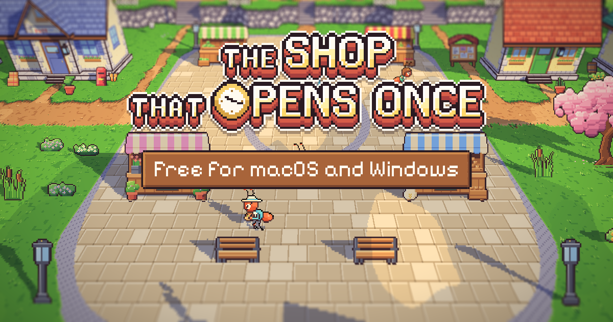

# 82. Situs pemasaran: gambar pratinjau tautan dan rilis di Vercel

**Tanggal:** 2026-10-24

## Tujuan

Pengguna memilih:

- **Gambar pratinjau:** judul game di atas alun-alun pagi hari.
- **Rilis:** di Vercel, dengan tautan pratinjau dulu.

## Yang dikerjakan

### Gambar pratinjau (`site/public/og.png`, 1200x630)

- Gambar ini dipakai saat tautan situs dibagikan di WhatsApp, Discord, atau X.
- **Isi:**
  - alun-alun Bellwood pagi hari, layar penuh dengan warganya;
  - di atasnya judul game (`ui/title.png`, 4x);
  - papan nama kayu bertuliskan "Free for macOS and Windows".
- **Cara membuat:** dirender dari situs itu sendiri, yaitu mode bermain layar penuh di 1200x630 dengan tombol-tombolnya
  disembunyikan. Jadi semua isinya seni game sendiri.
- **Tag `og:*` dan `twitter:card`** di `index.html`: judul, deskripsi, gambar (alamat lengkap, ukuran, dan teks alt).

### Vercel

- **Nama `the-shop-that-opens-once` sudah terpakai**, begitu juga `-game`:
  - `the-shop-that-opens-once.vercel.app` berisi presentasi GDD;
  - `the-shop-that-opens-once-game.vercel.app` berisi build game lama.

  Keduanya tidak disentuh.
- **Proyek baru:** pengguna memilih `the-shop-that-opens-once-site`, yang di-deploy dari folder `site/`.
- **Deploy pertama langsung menjadi produksi.** Vercel selalu menjadikan deploy pertama sebuah proyek sebagai
  produksi, jadi https://the-shop-that-opens-once-site.vercel.app sudah publik. Rencana awalnya pratinjau dulu. Deploy
  berikutnya menjadi pratinjau, kecuali diberi `--prod`.
- **Token tidak ikut:** `vercel link` membuat `.env.local` berisi token OIDC. Berkas ini dihapus, karena situs tidak
  memerlukan variabel lingkungan, dan `.env*` ditambahkan ke `.gitignore`.

## Gambar

## Verifikasi

- `bun run build`: bersih, dan `og.png` ada di `dist/`.
- **Situs yang sudah rilis:**
  - `/`, `/og.png`, `/art/ui/title.png`, `/art/ui/ui.json`, dan `/sound/bell.mp3` menjawab 200;
  - di 1440x900 (2x) tidak ada galat atau peringatan di console, dan tidak ada permintaan yang gagal;
  - `og:image` mengarah ke alamat produksi;
  - kursor game aktif.
- Alamat deploy itu sendiri (`…-praffis-projects.vercel.app`) dilindungi login Vercel (302).
