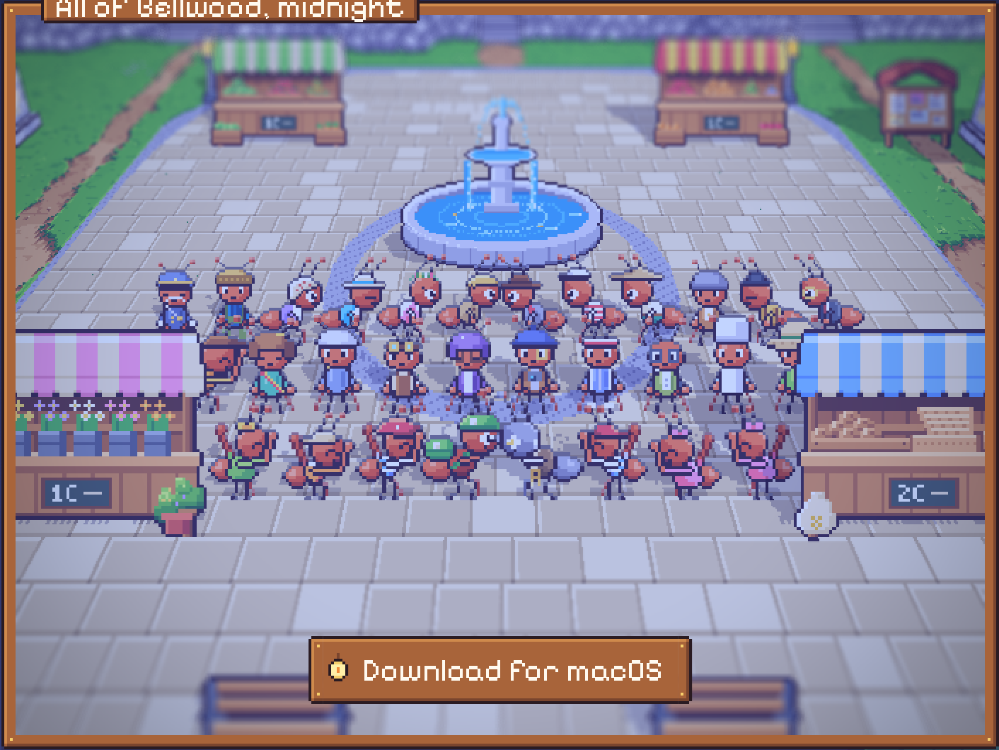
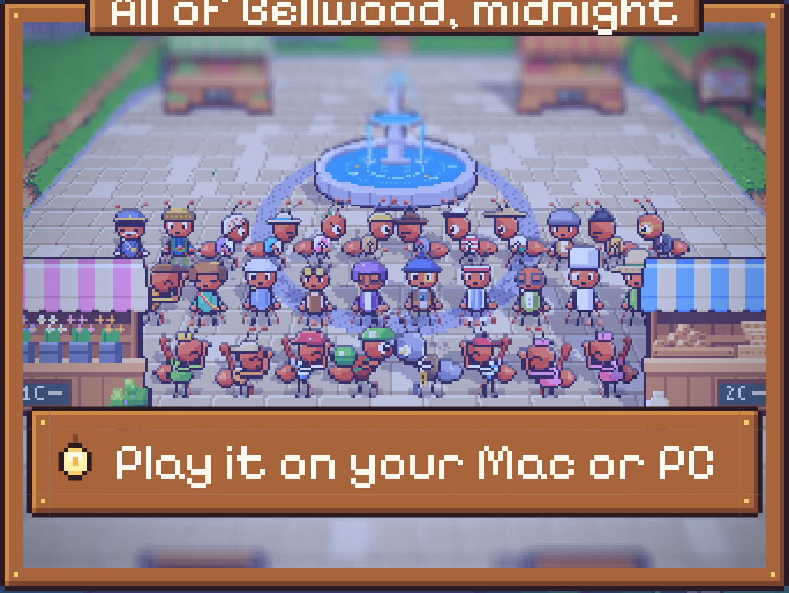

# 83. Situs pemasaran: jendela terakhir, seluruh Bellwood berkumpul

**Tanggal:** 2026-10-24

## Tujuan

Jendela di bagian terakhir (Unduh di pintu toko) sama dengan jendela bagian malam: toko Marlow di hutan beringin
dari sudut yang sama. Pengguna meminta gambar lain, tanpa membocorkan akhir cerita.

- Bagian dalam toko sempat dicoba, tetapi pengguna tidak suka.
- Pilihan pengguna: semua karakter dalam satu bingkai.

## Yang dikerjakan

### Foto bersama di alun-alun, tengah malam

- Seluruh warga berdiri di depan air mancur alun-alun seperti untuk foto bersama, dalam tiga baris:
  - **belakang:** orang dewasa, dari Kapten Bram dan Arlo sampai Agen Valdo di ujung;
  - **tengah:** Mia, Helen, Mender, Nora, Theo, Leo, Sam, Baker, Gardener, dan anak penjual roti;
  - **depan:** anak-anak yang bersorak (Pip, Gigi, Kiko, Lulu, dan lainnya), dengan Satria dan Marlow melambai di
    tengah.
- Yang punya pose menghadap depan berdiri menghadap kamera. Yang lain menghadap ke tengah.
- Setiap orang mulai di titik yang berbeda dalam animasinya, supaya tidak bergerak serempak.
- Alun-alun belum pernah tampil di malam hari di halaman ini, jadi jendela ini tidak mengulang jendela lain. Warga
  yang biasa berkeliling disembunyikan selama jendela ini tampil.
- Papan nama: "All of Bellwood, midnight" ("Seluruh Bellwood, tengah malam"), dengan deskripsi untuk pembaca layar
  dalam kedua bahasa.

### Tanpa bocoran

Jendela ini menampilkan 30 karakter, yaitu semua yang ditemui sampai Malam 5 (dicek dari skrip game). Yang tidak
ditampilkan:

- orang tua Satria (Ratih dan Daniel);
- Marcus, nama asli Marlow;
- wajah muda dari kilas balik (young_helen, young_pip, young_leo, young_satria);
- `traveller`, yang tidak dipakai game.

### Detail teknis

- Ke-30 semut dimuat setelah halaman siap, karena baru tampil di akhir halaman.
- Bayangan kaki naik dari 16 menjadi 32 semut (`MAX_FEET`).
- **Di ponsel**, barisan selebar 290 px seni tidak muat di jendela pada 2x. Kamera mundur ke 1x (bilangan bulat, tetap
  tajam di layar 3x), sehingga semua orang terlihat. Di desktop tetap 2x.

## Gambar

## Verifikasi

- `bun test`: 4 tes lulus.
- `bun run build`: bersih.
- Diuji di browser:
  - 1440x900 (2x): jendela pintu menampilkan alun-alun dengan semua warga, dan console tanpa galat;
  - 390x844 (3x, iPhone): zoom 1x, semua baris terlihat, dan halaman tanpa scroll ke samping;
  - kembali ke hero: zoom kembali 2x dan warga berkeliling lagi.
