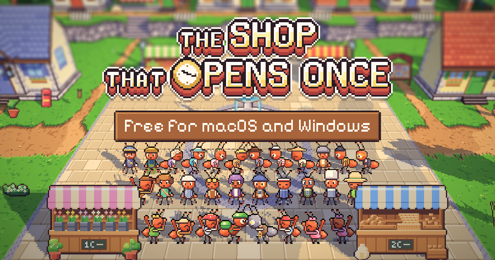

# 86. Situs pemasaran: gambar pratinjau dengan seluruh warga

**Tanggal:** 2026-10-24

## Tujuan

Saat tautan situs dibagikan, gambar pratinjaunya sudah bagus. Namun menurut pengguna latarnya "so plain": alun-alun
kosong dengan satu semut. Pengguna meminta latar seperti jendela terakhir, yaitu seluruh warga berkumpul.

## Yang dikerjakan

- **Gambar baru** (`site/public/og.png`, 1200x630):
  - judul game dan papan "Free for macOS and Windows" di atas;
  - di bawahnya ketiga baris warga di depan air mancur, sama dengan jendela terakhir (devlog 83).
- **Siang, bukan malam:**
  - gambar kecil di aplikasi chat lebih terbaca kalau terang;
  - sesuai pilihan awal pengguna untuk pratinjau, yaitu alun-alun pagi.
- **Cara membuat:** dirender dari situs seperti sebelumnya, dengan kamera sedikit diturunkan, supaya judul dan papan
  tidak menutupi kepala siapa pun dan baris depan tetap masuk bingkai.
- **Teks alt** `og:image:alt` diperbarui.
- **Alamat gambar** menjadi `og.png?v=2`. Aplikasi chat menyimpan gambar pratinjau berdasarkan alamatnya, jadi dengan
  alamat baru mereka mengambil gambar yang baru.

## Gambar

## Verifikasi

- `bun run build`: bersih, dan `og.png` yang baru ada di `dist/`.
- Gambar diperiksa: ketiga baris terlihat utuh, dan tidak ada kepala tertutup judul atau papan.
