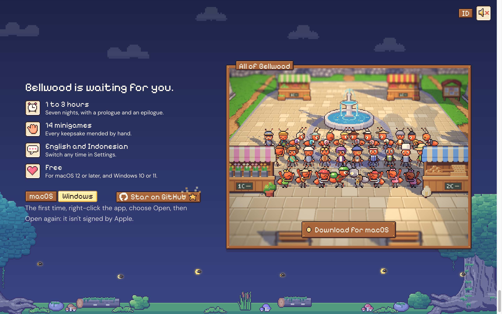

# 87. Situs pemasaran: jendela terakhir di pagi hari

**Tanggal:** 2026-10-24

## Tujuan

Pengguna bertanya apakah jendela terakhir (seluruh warga di alun-alun) lebih baik siang atau malam. Agen
merekomendasikan siang, dan pengguna setuju. Alasannya:

- **Tidak terbaca malam:** di malam hari batu alun-alun yang pucat menjadi abu-abu kebiruan yang datar, dan lampunya
  ada di luar bingkai.
- **Tenggelam di halaman:** di atas langit halaman yang sudah tengah malam, jendela ini menjadi yang paling redup,
  padahal di situ tombol Unduh berada.
- **Siang menonjol:** alun-alun yang terang menjadi hal paling terang di layar, dan sama dengan gambar pratinjau tautan
  (devlog 86).
- **Tetap masuk alur halaman:** halaman berjalan dari pagi ke tengah malam, dan jendela terakhir terbaca sebagai pagi
  sesudahnya, seperti irama game sendiri.

## Yang dikerjakan

- Jendela terakhir memakai cahaya pagi (waktu 0), seperti hero.
- Suara latarnya juga suara pagi.
- **Cahaya dipotong langsung**, seperti kamera, saat masuk dan keluar dari jendela ini. Sebelumnya cahaya berpindah
  perlahan, sehingga dari malam ke pagi sempat melewati senja jingga, seperti hari diputar mundur.

## Gambar

## Verifikasi

- `bun test`: 4 tes lulus.
- `bun run build`: bersih.
- Diuji di browser, 1440x900:
  - dari meja roda gigi (hutan beringin, waktu 2,97) ke jendela terakhir, waktunya langsung 0 di frame berikutnya;
  - kembali ke meja roda gigi, waktunya langsung 3;
  - console tanpa galat.
